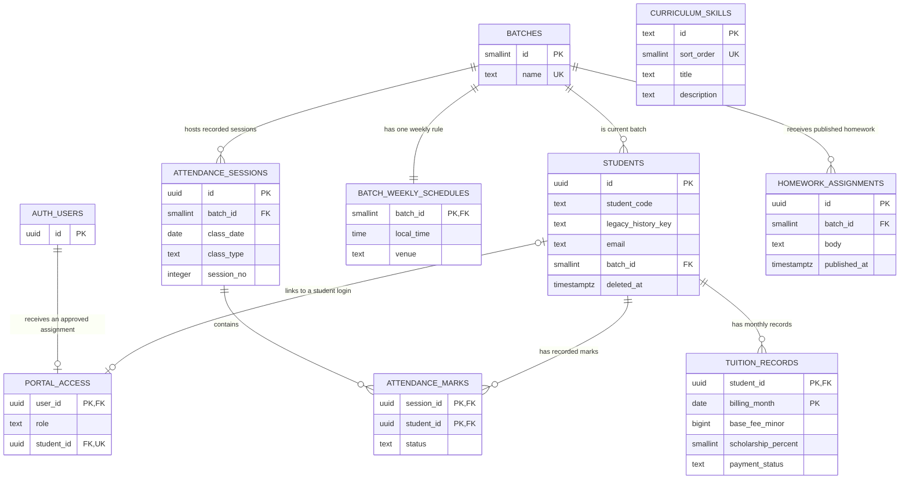

> **Status Notice (23 November 2026):** This earlier proposal has been **superseded** by [docs/DATABASE_DESIGN.md](docs/DATABASE_DESIGN.md) and the Day 1 handoff guide in [docs/DAY1_FOUNDATION_HANDOFF.md](docs/DAY1_FOUNDATION_HANDOFF.md). Retained below for historical context only.

# Ṭullāb al-Bayān database design

**Target:** Supabase PostgreSQL  
**Status:** Design proposal for the existing React frontend. No database changes have been applied.

## What the frontend does today

The app uses browser storage and demo accounts. Its route guards and hidden navigation links control the interface. Production authorization must be enforced by Supabase. The repository contains a Phase 1 Auth client and migration, but the current app entry point does not activate live sign-in. The visible sample accounts are the Saturday Student, Admin, and Teacher. A Sunday student fixture still exists in the demo account map. None of these credentials or fixture accounts should provision production users.

The current Admin workflow covers the roster, attendance, homework, tuition, and Curriculum Analysis. Teachers mark attendance and manage homework. Students read their own attendance and tuition and their current batch's homework and schedule. The weekly schedule and 12-book catalog are shared. Grades and Tuition Fee Waiver are hidden from navigation but their routes still exist.

## Entity relationships

The diagram omits optional Auth actor references for brevity. Curriculum skills are course-wide and have no batch or student relationship.

## Table specifications

Columns are required unless marked **nullable**. Omitted defaults mean the writer must provide the value. Proposed application tables are in `public` except `private.portal_access`. `auth.users` is managed by Supabase. For the app's timestamps, use `timestamptz` and update `updated_at` server-side on writes.

### `auth.users` and `private.portal_access`

Use `auth.users.id` as the provider-independent identity key. Read the signed-in user's email and optional display name or avatar through Auth. A student profile uses the institute roster's name, editable code, and batch. The role and record link always come from a trusted assignment.

| Column | Type | Rules |
|---|---|---|
| `user_id` | uuid | PK and FK to `auth.users(id)`, ON DELETE CASCADE |
| `role` | text | CHECK in `admin`, `teacher`, `student` |
| `student_id` | uuid | Nullable, unique FK to `students(id)`, ON DELETE RESTRICT. Required exactly when role is `student` |
| `staff_id` | text | Nullable. Optional institute staff identifier, nonblank when present and allowed only for staff |
| `created_at` | timestamptz | Default `now()` |
| `updated_at` | timestamptz | Default `now()` |

A trusted institute operator verifies the Google identity and approves the role or links an existing student row. Matching a roster email can help an operator find the row. Changing an email or OAuth profile metadata never grants access automatically. One Auth identity has at most one portal role in this design. No assignment means pending access and no institute data. The user's own basic Auth profile may still render. Unlinking a student or removing a staff assignment revokes data access on subsequent authorization checks without deleting academic or financial records. The PK and unique student FK provide the lookup indexes.

### `batches` and `batch_weekly_schedules`

| Table | Column | Type | Rules |
|---|---|---|---|
| `batches` | `id` | smallint | PK and ISO weekday, Monday 1 through Sunday 7 |
| `batches` | `name` | text | Unique. CHECK the seven exact weekday ID/name pairs |
| `batch_weekly_schedules` | `batch_id` | smallint | PK and FK to `batches(id)`, ON DELETE RESTRICT |
| `batch_weekly_schedules` | `local_time` | time without time zone | Nullable. Local start time in Asia/Dhaka |
| `batch_weekly_schedules` | `venue` | text | Nullable. Nonblank when provided |

Seed seven batches and one schedule row for each in the same controlled operation. The schedule is one weekly in-person class on the batch's weekday. The primary key ensures at most one rule per batch. Manage the invariant that all seven rules exist through operator seeding instead of exposing delete operations. Order cards Saturday through Friday in the application. Calculate dates and calendar month boundaries using the institute's `Asia/Dhaka` local date, for example `(now() AT TIME ZONE 'Asia/Dhaka')::date`. Expand weekdays over the requested month and find the next occurrence on or after today, even if it falls in the next month. Show time and venue only when provided. Weekly occurrences are derived and do not create attendance sessions.

### `students`

| Column | Type | Rules |
|---|---|---|
| `id` | uuid | PK, default `gen_random_uuid()`. Immutable identity used by dependent records |
| `student_code` | text | Editable UI ID. Trimmed and nonblank, with a unique index on `lower(student_code)` |
| `legacy_history_key` | text | Nullable and immutable after import. Trimmed and nonblank when present, with a unique index on `lower(legacy_history_key)` |
| `full_name` | text | Trimmed and nonblank |
| `email` | text | Lowercased, trimmed and nonblank. Unique across all rows. Check basic email shape with no whitespace. The current form does not require a Gmail domain |
| `batch_id` | smallint | FK to `batches(id)`, ON DELETE RESTRICT. Exactly one current batch |
| `deleted_at` | timestamptz | Nullable, default NULL. Set through an Admin archive operation |
| `created_at` | timestamptz | Default `now()` |
| `updated_at` | timestamptz | Default `now()` |

A transfer updates only `batch_id`. Soft deletion sets `deleted_at` and excludes the row from active lists and new attendance or tuition entry. Stable foreign keys preserve historical records. Keep code and email uniqueness across archived rows, matching the demo. For import compatibility, a new display code must also avoid another student's normalized legacy history key. Enforce this cross-column rule through a serialized roster write transaction or a normalized identifier registry. Separate unique indexes alone cannot enforce it. If an imported student uses their own legacy key as their display code, that is valid.

Use a partial index on `(batch_id, full_name, id) WHERE deleted_at IS NULL` for batch lists and counts. Consider a trigram index for substring name/code search only if data volume warrants it. The current schedule can show an unassigned message when no active linked roster row is found. A batchless enrollment state would require an explicit schema and workflow decision.

### `attendance_sessions`

| Column | Type | Rules |
|---|---|---|
| `id` | uuid | PK, default `gen_random_uuid()` |
| `batch_id` | smallint | FK to `batches(id)`, ON DELETE RESTRICT |
| `class_date` | date | Institute-local calendar date |
| `class_type` | text | CHECK in `Physical`, `Online`. `Physical` may display as “In-person class” |
| `session_no` | integer | Positive, assigned server-side, unique with `(batch_id, class_date)` as `(batch_id, class_date, session_no)` |
| `created_by` | uuid | Nullable FK to `auth.users(id)`, ON DELETE SET NULL. Set from the verified actor for app writes |
| `created_at` | timestamptz | Default `now()` |

The current UI allows multiple explicit sessions of the same type on a single batch/date. Do not impose uniqueness on `(batch_id, class_date, class_type)`. Allocate numbers atomically for a batch/date. For marking without a selected session, resolve the first matching type in session order or create one, and save the mark in one transaction. Serialize that lookup and creation to avoid duplicate implicit sessions. Prefer ID-based writes once a session is selected. Add `(class_date, batch_id)` for daily summaries and `(batch_id, class_date, class_type, session_no)` for implicit resolution if query plans benefit from it.

### `attendance_marks`

| Column | Type | Rules |
|---|---|---|
| `session_id` | uuid | FK to `attendance_sessions(id)`, ON DELETE RESTRICT. Part of composite PK |
| `student_id` | uuid | FK to `students(id)`, ON DELETE RESTRICT. Part of composite PK |
| `status` | text | CHECK in `Present`, `Late`, `Sick`, `Absent` |
| `marked_by` | uuid | Nullable FK to `auth.users(id)`, ON DELETE SET NULL. Set from the verified actor for app writes |
| `marked_at` | timestamptz | Default `now()`. Refresh when corrected |

Upsert on `(session_id, student_id)` so a correction replaces one mark. Validate that the requested session belongs to the selected batch and that the student is active and assigned to that batch at the time of marking. Perform the check with the write in a transaction that coordinates with roster transfers. An active roster left join yields **Unmarked** in the staff view when no mark exists. Student history can show **Unrecorded** for current-batch sessions without the student's mark. As in the frontend, include the student's previously marked sessions after a transfer even if those sessions belong to their former batch. The current rate counts Present plus Late over the four recorded statuses. Index `(student_id, session_id)` for personal history.

### `tuition_records`

| Column | Type | Rules |
|---|---|---|
| `student_id` | uuid | FK to `students(id)`, ON DELETE RESTRICT. Part of composite PK |
| `billing_month` | date | First day of the billing month. CHECK day = 1. Part of composite PK |
| `base_fee_minor` | bigint | Nullable, default NULL. BDT in poisha, from 0 through 99,999,999,999 to match the amount input |
| `scholarship_percent` | smallint | Default 0. CHECK in 0, 50, 100 |
| `payment_status` | text | Default `Unpaid`. CHECK in `Paid`, `Unpaid` |
| `updated_by` | uuid | Nullable FK to `auth.users(id)`, ON DELETE SET NULL. Set from the verified actor for app writes |
| `created_at` | timestamptz | Default `now()` |
| `updated_at` | timestamptz | Default `now()` |

Add `(billing_month, student_id)` for monthly administration and dashboard totals. Use a single derived calculation across admin views and the Student Ledger. Calculate in integer minor units. A 50% fee rounds half a poisha up, equivalent to `(base_fee_minor + 1) / 2` with integer division. A management roster starts with active batch members and left-joins the selected month. The ledger lists the student's actual stored months only. A transfer changes the current batch filter, while all ledger records stay attached to the same student. The Admin Student Ledgers, Payment Records, Scholarship Management and Tuition Management views are projections or controls over the same table.

| Conditions in precedence order | Amount due | Display status |
|---|---|---|
| Scholarship is 100%, including when no base fee was set | 0 | Covered by scholarship |
| Base fee is NULL or the monthly row is absent | NULL | Fee not set |
| Fee after scholarship is zero | 0 | No amount due |
| Positive fee after scholarship | Calculated amount | Stored Paid or Unpaid. Missing payment defaults to Unpaid |

Paid records track amounts received outside the app. In the current frontend, marking Paid changes the status while the displayed amount due continues to show the billed amount after scholarship. Only allow manual status changes while the calculated amount is positive. Preserve the underlying status when a scholarship temporarily eliminates the fee, matching the current repository. Enforce the status-write condition in the write operation instead of a static check that would reject an existing Paid record when coverage is applied. Admin updates should patch only the requested fields on the student/month row and avoid losing unrelated concurrent changes.

### `homework_assignments`

| Column | Type | Rules |
|---|---|---|
| `id` | uuid | PK, default `gen_random_uuid()` |
| `batch_id` | smallint | FK to `batches(id)`, ON DELETE RESTRICT |
| `body` | text | Must contain non-whitespace text. Store internal line breaks as entered |
| `deadline` | date | Nullable. Retains optional deadlines in existing demo fixtures. Current publishing form sets none |
| `published_by` | uuid | Nullable FK to `auth.users(id)`, ON DELETE SET NULL |
| `published_at` | timestamptz | Default `now()`. Set on initial publish and retain on edits |
| `updated_at` | timestamptz | Default `now()` |

Add `(batch_id, published_at DESC, id)` for the per-batch feed. Staff create, edit, and delete published entries. There is no draft state or student submission workflow. A new row is visible immediately. Students read only the feed of their current active batch, newest first. Preserve the current behavior that students who transfer read the destination batch's published feed. Staff delete removes the assignment, matching the demo. Retention or soft deletion for homework is an open policy choice.

### `curriculum_skills`

| Column | Type | Rules |
|---|---|---|
| `id` | text | PK. Stable skill slug, nonblank |
| `sort_order` | smallint | Positive and unique |
| `title` | text | Nonblank after whitespace trimming |
| `description` | text | Nonblank after whitespace trimming |
| `updated_at` | timestamptz | Default `now()` |

Seed Speaking, Writing, Listening, and Reading once. Admins edit titles/descriptions and delete cards. There is no Admin create or reorder screen, so browser clients should not receive these capabilities. Student and Teacher reads are shared, with no individualized progress data. The unique sort order is sufficient for the small catalog. A deployment should record the seed migration once rather than seed missing rows on each read or release.

## Access matrix and Row Level Security

**R** read, **I** insert, **U** update, **D** hard delete, **—** no access. Scope modifiers are part of the proposed policy. “Operator” means an institute-approved backend actor, not an application role obtained by demo sign-in.

| Resource | Admin | Teacher | Student | Trusted operator |
|---|---|---|---|---|
| Auth account and portal context | R own | R own | R own | Manage via approved Auth workflow |
| `private.portal_access` | — direct | — direct | — direct | R/I/U/D |
| Batches and schedule | R | R | R own active batch and schedule | R/I/U under fixed seed rules |
| Students | R/I/U, including soft deletion | R limited active roster projection | R own linked profile only | Approved roster maintenance and reconciliation |
| Attendance sessions | R/I | R/I for permitted batches | R current active batch's sessions and sessions with own marks | Maintenance only |
| Attendance marks | R/I/U | R/I/U for permitted batches | R own | Maintenance only |
| Tuition records | R/I/U | — | R own | Maintenance only |
| Homework assignments | R/I/U/D | R/I/U/D for permitted batches | R own active batch's feed | Maintenance only |
| Curriculum skills | R/U/D | R | R | R/I/U/D for controlled maintenance |

Implementation notes:

- Enable RLS on every API-exposed table, revoke automatic/default grants where applicable, and grant only the operations and columns needed. Apply `USING` to reads and existing rows, and `WITH CHECK` to inserted or updated rows. Where direct writes cannot protect identity, scope or immutable fields, use narrowly granted server actions or RPCs that explicitly verify the caller and enforce those invariants. Privileged keys stay server-side. [Supabase RLS guide](https://supabase.com/docs/guides/database/postgres/row-level-security)
- Resolve the caller with `auth.uid()` and the private approval record. Use a restricted, schema-qualified lookup helper with a pinned empty search path if a security-definer function is needed to read private data or avoid recursive RLS. Expose only the derived context needed by the caller. Never publish direct access to `auth.users`. Leave unauthenticated and pending users without institute records. [Supabase user data guide](https://supabase.com/docs/guides/auth/managing-user-data)
- Give Teachers a projected batch roster with the IDs and names needed to mark attendance and show batch counts. Avoid granting Teacher reads on full student rows just to match the demo's local storage implementation. An API endpoint must enforce teacher/batch access before reading records and must return only the projected fields. Today the frontend lets both staff roles work with all seven batches. A narrower Teacher assignment policy is an institute decision and would need its own association table and UI changes.
- For student attendance, authorize sessions independently of marks and project only the caller's own mark. For tuition, bind the student's stable UUID to the approved identity on the server. Never accept a client-selected student ID as authority to read a ledger or grades. Dashboard summaries must follow the same access scope.
- Protect roster keys and login links from ordinary Admin edits. A close match to the UI is to allow active roster management while reservations and archived identity/history remain available to trusted maintenance. The proposal retains linked students' own attendance and tuition history after archival and blocks active-batch reads. The institute should confirm this rule before a live rollout. Account revocation remains a separate operator action.
- Keep Teacher tuition access denied at the database and API layers, including aggregates. Browser and API verification should exercise anonymous and pending access, cross-student reads, Teacher finance requests, role escalation, unauthorized direct writes, and the current role behavior. Views must preserve base-table RLS, for example with `security_invoker` where supported, or enforce equivalent checks in the server interface. [Supabase RLS guide](https://supabase.com/docs/guides/database/postgres/row-level-security)

## Frontend mapping and migration boundaries

| Current source | Proposed destination or behavior |
|---|---|
| `App.jsx` session key `bayan-demo-role` and fixture accounts | Demo session only. Replace for live use with Supabase Auth and the trusted portal context. Do not import demo credentials or promote a browser role flag |
| `rosterRepository.js`, `bayan-roster-v2` and legacy `bayan-roster-v1` | `batches`, `students`. Map `historyId → id` once and retain the original as `legacy_history_key`. Map editable `id → student_code`, and `deletedAt → deleted_at`. Respect v2 precedence and archive flags |
| `attendanceRepository.js`, `bayan-attendance-v1` | `attendance_sessions` and `attendance_marks`. Map source session IDs to UUIDs once, retain multiple sessions per batch/date/type, and resolve mark keys through the student history map |
| `studentSchedule.js` and `academicRepository.js` schedule consumers | `batches` and `batch_weekly_schedules`. Shared weekday rule and optional details. Do not import computed calendar dates as recorded attendance |
| `tuitionRepository.js`, `bayan-tuition-v1` | `tuition_records`. Split the fixed `YYYY-MM:` prefix from the remaining history key. Convert month to its first day. Existing fees are already minor units. A missing row remains missing |
| `homeworkRepository.js`, `bayan-homework-v1` | `homework_assignments`. Import approved text, batch, original publish date, and deadline if any. Handle non-UUID demo keys with an import ID map |
| `curriculumSkills.js`, `bayan-curriculum-skills-v2` and legacy `bayan-curriculum-skills-v1` | `curriculum_skills`. Prefer v2, including an empty list. The app's v1 migration translates untouched default fields and replaces only the untouched oral presentation card with Reading. Preserve edits, order and deletions if importing approved settings |
| `curriculumBooks.js` and `public/curriculum/covers` | Keep the ordered 12-book catalog and cover assets in the frontend for now |
| `academicRepository.js` grades fixtures and Wi-Fi provider | Demo student-only published grades and a Wi-Fi empty state. No current persistence. See deferred designs below |
| `demo.js`, `demoRoster.js`, and `bayan-demo-v1` | Shared seed fixtures and a legacy demo snapshot reader. The feature repositories use their own stores. Use fixture data only in development and tests unless the institute explicitly approves the content. The roster CSV parser is a helper, not a live import job |

For an approved import, resolve roster identities before attendance and tuition. For example, the demo display code `SAT-001` uses `AB-001` for historical joins. Never join by name, batch, email, or the current display code. Quarantine unresolved references for review. The attendance fixtures can contain a legacy `AB-002` mark even when the active demo roster does not contain that legacy student. Do not silently assign it to a similarly numbered student. Reconcile imported records against the institute's official data before publication.

## Static, hidden, and deferred features

- **Curriculum Details.** Keep the order, alt text, and approved PNGs in source control while changes are infrequent and there is no catalog editor. This avoids database and Storage policies for a static catalog. If the institute needs to publish covers without a frontend deployment, add a future `curriculum_books` table keyed by book number with ordering, alt text, and Storage object path, plus a restricted upload workflow. Confirm rights and desired public visibility before choosing a public or private bucket.
- **Grades.** The route still exists despite the hidden link. The current student page filters fixtures to its own published grades and staff pages do not show grades. If enabled for live use, model assessments and student results with separate publishing and editing permissions. Define grading scales and the authorized publisher first.
- **Tuition Fee Waiver.** Its hidden route uses existing tuition data and needs no separate waiver table for the current percentage model.
- **Online Payment.** The route is an unavailable notice. A future payment integration needs verified provider events, separate payment transactions, and reconciliation with invoiced amounts. The current manual status is a different workflow.
- **Bayan Wi-Fi.** The page currently has no connection instructions to publish. If added, store approved instructions with appropriate visibility and leave credentials outside public assets.

## Differences from the existing Supabase migration

The checked-in migration creates `public.bayan_staff_access` and `public.bayan_student_profiles` with SELECT grants and self-read policies. It lets admins read the roster. The student table uses the editable display ID as its primary key, a nullable unique Auth UUID, and a checked weekday string. It has no roster email, stable surrogate ID, archive timestamp, schedule, attendance, fees, homework, or skills. The current live auth helper reads both existing tables and checks staff first. Review it together with the migration and setup instructions before replacing any interface. [Existing migration](frontend/supabase/migrations/202611200001_phase1_access.sql) · [Auth setup](frontend/AUTH_SETUP.md)

The proposed model consolidates approved access into a private assignment table, uses a stable student UUID for history, normalizes batches, and models narrowly authorized writes. Future migration work must backfill IDs and links, check duplicates and conflicting roles, and either update the Auth helper and repositories together or provide narrowly scoped compatibility interfaces. Confirm whether the Phase 1 migration is deployed before relying on any backfill assumptions.

## Open decisions before implementation

1. **Teacher access.** Confirm all-seven-batch access or per-batch staff assignment, and whether teachers should be allowed to revise historical attendance or homework.
2. **Transfers and withdrawal.** Confirm whether archived linked students keep self-service history and whether enrollment history is needed to calculate past unmarked attendance or historical batch-specific tuition. The current demo uses today's batch roster and retained marks. If exact historical membership is needed, add dated enrollments or session roster snapshots as a separate feature.
3. **Fee changes after payment.** The demo retains the manual payment flag when fees or scholarships change. Confirm if live use should require reconfirmation, store an amount actually paid, or retain payment audit history.
4. **Scheduling exceptions.** The current calendar is a weekly rule. Confirm requirements for holidays, make-up classes, changes to start time, and historic schedule changes before adding overrides.
5. **Operational policy.** Confirm official import sources, account approval and revocation procedures, audit and retention needs, and restored-archive workflows. Decide whether multiple roles on one Auth identity are needed before altering the proposed single-role rule.

**Cross-check:** The design was compared with the existing route configuration, demo account handling, role-specific screens, feature repositories, and Phase 1 Auth setup. This document describes a proposal and contains no applied migration or database changes.
