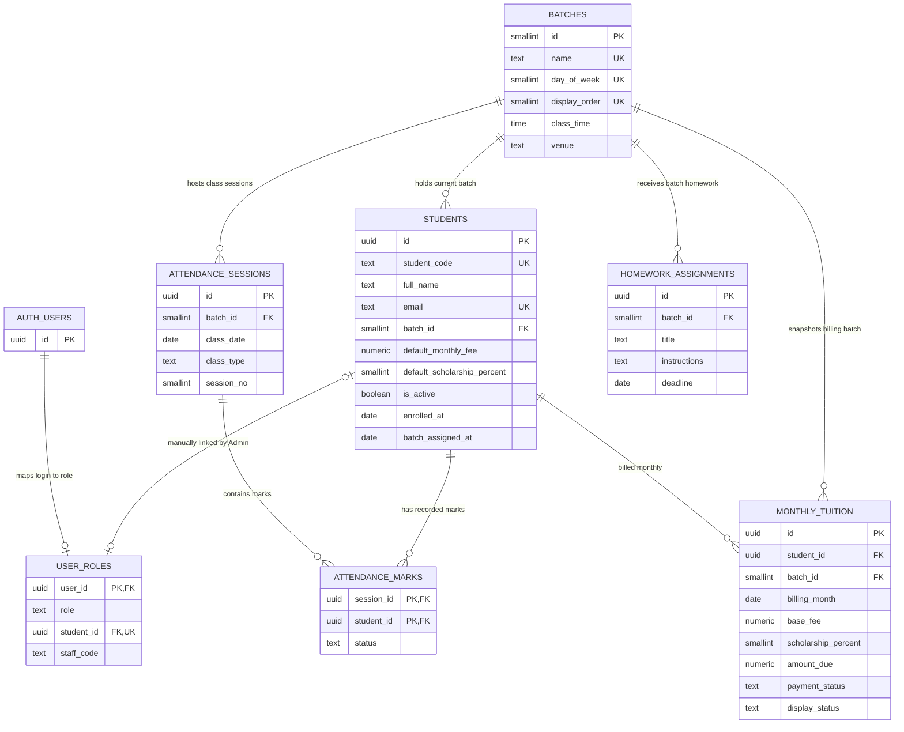

# Al Bayan Student Management System (Ṭullāb al-Bayān) — Final Database Design & Implementation Guide

- **Status:** **FINAL LOCKED PRODUCTION DESIGN** (22 November 2026 — Zero Open Issues)
- **Next Implementation Handoff:** See [docs/IFFAT_IMPLEMENTATION_HANDOFF.md](./IFFAT_IMPLEMENTATION_HANDOFF.md) for current implementation status, verified database/security architecture, Iffat's remaining tasks (`StaffDashboard`, `AcademicCalendar`, `CurriculumAnalysis`, `AdminExport`), the approved **Option 2 Teacher Listing & 1-Click Approval** architecture, and required test scenarios.
- **Target Scale:** ~200 students, 1 institute (`Asia/Dhaka` timezone, `BDT` currency)
- **Stack:** React + Tailwind CSS (Vercel) · Supabase PostgreSQL + Supabase Auth · Supabase CLI Forward Migrations

---

## 1. Project & Database Overview

This schema is locked to all confirmed PM and Owner decisions and sized cleanly for ~200 students using **7 PostgreSQL tables** (zero `tuition_payments` table, zero `curriculum_skills` table, zero enterprise bloat):

1. `public.user_roles` — Auth role mapping (`admin`, `teacher`, `student`) with manual Admin student linking.
2. `public.batches` — Fixed 7 weekday batches (`Saturday` through `Friday`) with optional `class_time` & `venue`.
3. `public.students` — Student master roster with immutable `uuid` PK, editable `student_code`, `email`, default fee/scholarship, soft deactivation, and `enrolled_at` / `batch_assigned_at` dates.
4. `public.attendance_sessions` — Dated `Physical` / `Online` class sessions per batch (empty sessions deletable).
5. `public.attendance_marks` — One mark (`Present`, `Late`, `Sick`, `Absent`) per student per session.
6. `public.monthly_tuition` — Monthly billing snapshot (`base_fee`, `scholarship_percent`, generated `amount_due` & `display_status`, manual `Paid`/`Unpaid`, `paid_at`).
7. `public.homework_assignments` — Batch-specific homework (`title`, `instructions`, optional `deadline`).

### Frontend-Only / Static Pages (NO Database Tables)
- **Curriculum Details** (`/*/curriculum-details`): Static 12-book catalog + local cover PNGs.
- **Curriculum Analysis** (`/*/curriculum-analysis`): Static frontend image display with a **"Feature coming soon"** alert bar — **no database table, no `localStorage`, and no Edit/Delete controls**.
- **Placeholder / Hidden Routes**: `Online Payment` and `Bayan Wi-Fi` hidden from sidebar; `Grades` and `Tuition Fee Waiver` stay out of sidebar with no new tables.

### Confirmed Decisions Summary (22 November 2026)

| # | Topic | Final Locked Rule |
|---|---|---|
| 1 | Teacher Access | Teachers access Attendance & Homework across **all 7 batches**; Tuition and Student emails are restricted via `get_teacher_roster()`. |
| 2 & 9 | Tuition Tracking | Monthly manual **`Paid` / `Unpaid`** per student (`0%`/`50%`/`100%` scholarships, two-decimal `BDT`). Partial/individual payments excluded. |
| 3 & 15 | Attendance & Rates | 4 statuses (`Present`, `Late`, `Sick`, `Absent`); rate = `(Present + Late) / total marked` (including `Sick`), shown as **Physical %**, **Online %**, and **Overall %**; empty sessions deletable; unmarked sessions before `GREATEST(enrolled_at, batch_assigned_at)` omitted. |
| 4 | Batches | Strictly **7 fixed weekday batches** (`Saturday`–`Friday`), protected by table `CHECK` constraint and revoked `INSERT`/`DELETE`. |
| 5 & 16 | Homework | **`title` + `instructions` + optional `deadline`**, strictly **one batch per assignment** (overdue flagged in UI). |
| 6 & 11 | Auth & Linking | Admins sign in with **Google** (pre-approved); students sign in with Google and an **Admin manually links** unlinked accounts in UI (`pending` awaiting-access screen until linked). |
| 7 | Former Students | Deactivated (`is_active = false`) students retain **read-only access** to their own historical attendance (`marked` sessions only) and tuition; batch homework and active weekly calendar are blocked (`0` rows). |
| 8 | Curriculum & Phase 1 | `Curriculum Analysis` is a **static image-only page with a "Feature coming soon" bar** (no DB table). **Phase 1 SQL is already live** — rollout uses zero-downtime **forward migrations** preserving existing links/assignments, verified on **staging first**. |
| 10 & 12 | Roster & CSV | CSV imports `student_id, full_name, email, batch` (+ optional fee/scholarship defaults). Admin UI adds fee/scholarship defaults and inactive view with reactivation. |
| 13, 14, 17, 18 | Operations & UI | Monthly generation RPC; Admin ZIP/CSV export across **6 CSV files + `manifest.json`**; live staff dashboards + Admin-editable batch `class_time`/`venue`; hide `Online Payment` & `Bayan Wi-Fi`; keep 12 static book covers. |

### Entity-Relationship Diagram



---

## 2 & 3. Final Table Definitions, Keys & Relationships

All application tables reside in `public` with RLS enabled (`ENABLE ROW LEVEL SECURITY`) and explicit least-privilege grants (`auth.users` is managed by Supabase Auth). Timestamps use `timestamptz`; calendar dates follow `Asia/Dhaka`.

### 3.1 `public.user_roles`
**Purpose:** Maps approved Supabase Auth accounts (`auth.users.id`) to portal roles (`admin`, `teacher`, `student`) and, for students, links manually to one `students.id`. Replaces `public.bayan_staff_access` and the `user_id` column on `public.bayan_student_profiles`.

| Column | Type | Nullable | Default | Constraints & Notes |
|---|---|---|---|---|
| `user_id` | `uuid` | NO | — | `PRIMARY KEY`, `REFERENCES auth.users(id) ON DELETE CASCADE` |
| `role` | `text` | NO | — | `CHECK (role IN ('admin', 'teacher', 'student'))` |
| `student_id` | `uuid` | YES | `NULL` | `UNIQUE`, `REFERENCES public.students(id) ON DELETE RESTRICT` |
| `staff_code` | `text` | YES | `NULL` | Optional institute staff ID (`CHECK (staff_code IS NULL OR btrim(staff_code) <> '')`) |
| `full_name` | `text` | YES | `NULL` | Optional display name override for staff (`MyProfile.jsx`) |
| `created_at` | `timestamptz` | NO | `now()` | Server-set creation timestamp |
| `updated_at` | `timestamptz` | NO | `now()` | Maintained by `set_updated_at()` trigger |

- **Table Constraint:** `CHECK ((role = 'student' AND student_id IS NOT NULL AND staff_code IS NULL) OR (role IN ('admin', 'teacher') AND student_id IS NULL))`.
- **Linking Rule:** Unlinked Google accounts have **no row** in `user_roles` and see only the "Awaiting institute access" screen. Admins link signed-in students using `link_student_account()` in the UI and can inspect linked status via `SELECT` RLS (`user_id = (SELECT auth.uid()) OR (SELECT public.current_user_role()) = 'admin'`).

---

### 3.2 `public.batches`
**Purpose:** Fixed 7 weekday batches (`Saturday`–`Friday`) with Admin-editable `class_time` and `venue` for the Academic Calendar.

| Column | Type | Nullable | Default | Constraints & Notes |
|---|---|---|---|---|
| `id` | `smallint` | NO | — | `PRIMARY KEY` (`1` = Saturday .. `7` = Friday) |
| `name` | `text` | NO | — | `UNIQUE`, exact weekday name |
| `day_of_week` | `smallint` | NO | — | `UNIQUE`, JS/Postgres weekday (`0` = Sun .. `6` = Sat) |
| `display_order` | `smallint` | NO | — | `UNIQUE`, `1`..`7` (`Saturday`..`Friday`) |
| `class_time` | `time` | YES | `NULL` | Optional local start time in `Asia/Dhaka` |
| `venue` | `text` | YES | `NULL` | Optional classroom/location (`CHECK (venue IS NULL OR btrim(venue) <> '')`) |
| `created_at` | `timestamptz` | NO | `now()` | Server-set creation timestamp |
| `updated_at` | `timestamptz` | NO | `now()` | Maintained by `set_updated_at()` trigger |

- **Fixed 7-Batch Constraint:**
  ```sql
  CHECK (
    (id = 1 AND name = 'Saturday'  AND day_of_week = 6 AND display_order = 1) OR
    (id = 2 AND name = 'Sunday'    AND day_of_week = 0 AND display_order = 2) OR
    (id = 3 AND name = 'Monday'    AND day_of_week = 1 AND display_order = 3) OR
    (id = 4 AND name = 'Tuesday'   AND day_of_week = 2 AND display_order = 4) OR
    (id = 5 AND name = 'Wednesday' AND day_of_week = 3 AND display_order = 5) OR
    (id = 6 AND name = 'Thursday'  AND day_of_week = 4 AND display_order = 6) OR
    (id = 7 AND name = 'Friday'    AND day_of_week = 5 AND display_order = 7)
  )
  ```
- **Permissions:** Seeded once in Migration `202611230001`. `INSERT` and `DELETE` are revoked from all client roles; Admins receive column-level `UPDATE (class_time, venue)` only.

---

### 3.3 `public.students`
**Purpose:** Master student roster using an immutable `uuid` PK (`id`) so editing `student_code` or changing `batch_id` never breaks historical records.

| Column | Type | Nullable | Default | Constraints & Notes |
|---|---|---|---|---|
| `id` | `uuid` | NO | `gen_random_uuid()` | `PRIMARY KEY` (immutable identity; replaces `bayan_student_profiles.student_id` PK) |
| `student_code` | `text` | NO | — | Editable display ID (e.g., `SAT-001`), `CHECK (btrim(student_code) <> '')` |
| `full_name` | `text` | NO | — | Trimmed nonblank (`CHECK (btrim(full_name) <> '')`) |
| `email` | `text` | YES* | `NULL` | Lowercased & trimmed; `CHECK (email IS NULL OR (email = lower(btrim(email)) AND email !~ '\s' AND email ~ '^[^@]+@[^@]+\.[^@]+$'))` |
| `batch_id` | `smallint` | NO | — | `REFERENCES public.batches(id) ON DELETE RESTRICT` |
| `default_monthly_fee` | `numeric(10, 2)` | YES | `NULL` | BDT default (`CHECK (default_monthly_fee IS NULL OR default_monthly_fee >= 0)`) |
| `default_scholarship_percent` | `smallint` | NO | `0` | `CHECK (default_scholarship_percent IN (0, 50, 100))` |
| `is_active` | `boolean` | NO | `true` | `false` = former/inactive student |
| `enrolled_at` | `date` | NO | `(now() AT TIME ZONE 'Asia/Dhaka')::date` | Initial join date |
| `batch_assigned_at` | `date` | NO | `(now() AT TIME ZONE 'Asia/Dhaka')::date` | Auto-updated when `batch_id` changes (prevents pre-transfer `Unrecorded` sessions) |
| `deactivated_at` | `timestamptz` | YES | `NULL` | Set on deactivation; cleared on reactivation |
| `created_at` | `timestamptz` | NO | `now()` | Server-set creation timestamp |
| `updated_at` | `timestamptz` | NO | `now()` | Maintained by `set_updated_at()` trigger |

- **\*Legacy Migration Note on `email`:** Phase 1 `bayan_student_profiles` has no `email` column. Keeping `email` nullable in Migration `202611230001` allows unlinked legacy rows to migrate without failing; all **new** UI/CSV inserts require `email` (`NOT NULL`), and Migration `202611230006` enforces `ALTER TABLE public.students ALTER COLUMN email SET NOT NULL` once legacy rows are backfilled.
- **Unique Indexes & Constraints:**
  - `UNIQUE INDEX uq_students_code_lower ON public.students (lower(btrim(student_code)))`
  - `UNIQUE INDEX uq_students_email_lower ON public.students (lower(btrim(email))) WHERE email IS NOT NULL`
  - `CHECK ((is_active = true AND deactivated_at IS NULL) OR (is_active = false AND deactivated_at IS NOT NULL))`

---

### 3.4 `public.attendance_sessions`
**Purpose:** Dated `Physical` or `Online` class sessions per batch. Supports multiple sessions per date; empty sessions (`0` marks) can be deleted by staff.

| Column | Type | Nullable | Default | Constraints & Notes |
|---|---|---|---|---|
| `id` | `uuid` | NO | `gen_random_uuid()` | `PRIMARY KEY` |
| `batch_id` | `smallint` | NO | — | `REFERENCES public.batches(id) ON DELETE RESTRICT` |
| `class_date` | `date` | NO | `(now() AT TIME ZONE 'Asia/Dhaka')::date` | Institute-local date |
| `class_type` | `text` | NO | — | `CHECK (class_type IN ('Physical', 'Online'))` |
| `session_no` | `smallint` | NO | `1` | `CHECK (session_no > 0)`, allocated atomically per `(batch_id, class_date)` |
| `created_by` | `uuid` | YES | `NULL` | `REFERENCES auth.users(id) ON DELETE SET NULL` |
| `created_at` | `timestamptz` | NO | `now()` | Server-set creation timestamp |

- **Unique Constraint:** `UNIQUE (batch_id, class_date, session_no)`.

---

### 3.5 `public.attendance_marks`
**Purpose:** Stores one mark per student per session. Unmarked students have no row and render dynamically as `Unmarked` (staff) or `Unrecorded` (active students on eligible sessions).

| Column | Type | Nullable | Default | Constraints & Notes |
|---|---|---|---|---|
| `session_id` | `uuid` | NO | — | `REFERENCES public.attendance_sessions(id) ON DELETE RESTRICT` |
| `student_id` | `uuid` | NO | — | `REFERENCES public.students(id) ON DELETE RESTRICT` |
| `status` | `text` | NO | — | `CHECK (status IN ('Present', 'Late', 'Sick', 'Absent'))` |
| `marked_by` | `uuid` | YES | `NULL` | `REFERENCES auth.users(id) ON DELETE SET NULL` |
| `marked_at` | `timestamptz` | NO | `now()` | Initial mark timestamp |
| `updated_at` | `timestamptz` | NO | `now()` | Updated on mark correction |

- **Primary Key:** `PRIMARY KEY (session_id, student_id)` — guarantees zero duplicate marks.

---

### 3.6 `public.monthly_tuition`
**Purpose:** Monthly tuition record per student per billing month using manual `Paid` / `Unpaid` tracking. Snapshots `batch_id`, `base_fee`, and `scholarship_percent` at generation time.

| Column | Type | Nullable | Default | Constraints & Notes |
|---|---|---|---|---|
| `id` | `uuid` | NO | `gen_random_uuid()` | `PRIMARY KEY` |
| `student_id` | `uuid` | NO | — | `REFERENCES public.students(id) ON DELETE RESTRICT` |
| `batch_id` | `smallint` | NO | — | `REFERENCES public.batches(id) ON DELETE RESTRICT` (historical batch snapshot) |
| `billing_month` | `date` | NO | — | Normalized 1st of month (`CHECK (EXTRACT(DAY FROM billing_month) = 1)`) |
| `base_fee` | `numeric(10, 2)` | YES | `NULL` | BDT fee (`CHECK (base_fee IS NULL OR base_fee >= 0)`) |
| `scholarship_percent` | `smallint` | NO | `0` | `CHECK (scholarship_percent IN (0, 50, 100))` |
| `amount_due` | `numeric(10, 2)` | YES | `GENERATED ALWAYS AS (...) STORED` | `CASE WHEN scholarship_percent = 100 THEN 0.00 WHEN base_fee IS NULL THEN NULL ELSE ROUND(base_fee * (100 - scholarship_percent) / 100.0, 2) END` |
| `payment_status` | `text` | NO | `'Unpaid'` | `CHECK (payment_status IN ('Paid', 'Unpaid'))` |
| `display_status` | `text` | NO | `GENERATED ALWAYS AS (...) STORED` | `CASE WHEN scholarship_percent = 100 THEN 'Covered by scholarship' WHEN base_fee IS NULL THEN 'Fee not set' WHEN ROUND(base_fee * (100 - scholarship_percent) / 100.0, 2) = 0 THEN 'No amount due' ELSE payment_status END` |
| `paid_at` | `timestamptz` | YES | `NULL` | Audit timestamp maintained automatically by trigger when `payment_status` transitions |
| `notes` | `text` | YES | `NULL` | Optional admin note (e.g., mid-month prorated adjustment) |
| `updated_by` | `uuid` | YES | `NULL` | `REFERENCES auth.users(id) ON DELETE SET NULL` |
| `created_at` | `timestamptz` | NO | `now()` | Server-set creation timestamp |
| `updated_at` | `timestamptz` | NO | `now()` | Maintained by `set_updated_at()` trigger |

- **Unique Constraint:** `UNIQUE (student_id, billing_month)`.
- **PostgreSQL Rule:** `display_status` evaluates `base_fee` and `scholarship_percent` directly because PostgreSQL does not allow referencing another generated column (`amount_due`).
- **Upsert Rule:** Always preserve the original `batch_id` snapshot on `ON CONFLICT (student_id, billing_month) DO UPDATE`—never overwrite historical `batch_id` when updating a fee or payment status.

---

### 3.7 `public.homework_assignments`
**Purpose:** Batch-specific weekly homework assignments with title, instructions, and optional deadline.

| Column | Type | Nullable | Default | Constraints & Notes |
|---|---|---|---|---|
| `id` | `uuid` | NO | `gen_random_uuid()` | `PRIMARY KEY` |
| `batch_id` | `smallint` | NO | — | `REFERENCES public.batches(id) ON DELETE RESTRICT` (strictly 1 batch per assignment) |
| `title` | `text` | NO | — | `CHECK (btrim(title) <> '')` |
| `instructions` | `text` | NO | — | `CHECK (btrim(instructions) <> '')` |
| `deadline` | `date` | YES | `NULL` | Optional `Asia/Dhaka` due date |
| `published_by` | `uuid` | YES | `auth.uid()` | `REFERENCES auth.users(id) ON DELETE SET NULL`, preserved across edits |
| `published_at` | `timestamptz` | NO | `now()` | Preserved across edits |
| `updated_at` | `timestamptz` | NO | `now()` | Maintained by `set_updated_at()` trigger |

---

## 4. Constraints, Indexes, Triggers & RPCs

### Indexes

| Table | Index Definition | Purpose |
|---|---|---|
| `user_roles` | PK `(user_id)`, Unique `(student_id)` | O(1) role & student lookup in RLS |
| `students` | `uq_students_code_lower` UNIQUE `(lower(btrim(student_code)))` | Case-insensitive unique Student ID |
| `students` | `uq_students_email_lower` UNIQUE `(lower(btrim(email))) WHERE email IS NOT NULL` | Case-insensitive unique roster email |
| `students` | `idx_students_active_batch` `(batch_id, full_name) WHERE is_active = true` | Active roster listing & batch counts |
| `attendance_sessions` | UNIQUE `(batch_id, class_date, session_no)` + `idx_sessions_date_batch` `(class_date DESC, batch_id)` | Daily dashboard & range exports |
| `attendance_marks` | PK `(session_id, student_id)` + `idx_marks_student` `(student_id, session_id)` | Fast session marks & student history |
| `monthly_tuition` | UNIQUE `(student_id, billing_month)` + `idx_tuition_month_batch` `(billing_month DESC, batch_id)` | Admin month table & Student Ledger |
| `homework_assignments` | `idx_homework_batch_deadline` `(batch_id, deadline ASC NULLS LAST, published_at DESC)` | Batch homework feed sorted by deadline |

### Triggers
1. **`set_updated_at()`**: `BEFORE UPDATE` trigger maintaining `NEW.updated_at = now()` on `user_roles`, `batches`, `students`, `attendance_marks`, `monthly_tuition`, and `homework_assignments`.
2. **`normalize_student_fields()`**: `BEFORE INSERT OR UPDATE` on `students` — trims `student_code` & `full_name`, trims/lowercases `email` (`NULLIF(..., '')`); on `UPDATE`, if `NEW.batch_id IS DISTINCT FROM OLD.batch_id` **or** on Option A reactivation (`OLD.is_active = false AND NEW.is_active = true`), sets `NEW.batch_assigned_at = (now() AT TIME ZONE 'Asia/Dhaka')::date`; ensures `deactivated_at` is set when `is_active = false` and cleared when `is_active = true`.
3. **`protect_homework_publish_metadata()`**: `BEFORE INSERT OR UPDATE` on `homework_assignments` — trims `NEW.title` (preserving internal line breaks in `instructions`) and, on `UPDATE`, preserves `OLD.published_at` and `OLD.published_by`.
4. **`validate_monthly_tuition_write()`**: *(Planned in `202611230004`)* `BEFORE INSERT OR UPDATE` on `monthly_tuition` — computes effective due amount from `base_fee` and `scholarship_percent`; rejects setting `payment_status = 'Paid'` on `INSERT`, or changing `payment_status` to `'Paid'` on `UPDATE`, when due is `NULL` or `<= 0`; maintains `paid_at = now()` on `'Paid'` and `NULL` on `'Unpaid'`.

### Essential RPC Functions (`SECURITY DEFINER SET search_path = ''`)

| Function | Caller | Purpose |
|---|---|---|
| `current_user_role()` | Any authenticated | Returns `role` from `public.user_roles` for `auth.uid()` (`NULL` if pending). |
| `current_student_id()` | Any authenticated | Returns `student_id` from `public.user_roles` for `auth.uid()`. |
| `is_active_student()` | Any authenticated | Returns `true` iff caller is a linked student with `students.is_active = true`. |
| `get_teacher_roster()` | Admin / Teacher | Returns active `(id, student_code, full_name, batch_id)` ONLY — hides student `email`, fee defaults, and inactive rows from Teachers. |
| `list_pending_auth_users()` | Admin only | Queries `auth.users` minus `public.user_roles` so Admins can manually link signed-in students inside the UI without opening Supabase Dashboard SQL Editor. Returns `(user_id, email, full_name, created_at)` only. |
| `link_student_account(p_student_id uuid, p_user_id uuid)` | Admin only | Verifies `p_user_id` is not staff or linked to another student; links `user_roles(user_id, role='student', student_id)`. |
| `unlink_student_account(p_student_id uuid)` | Admin only | Removes the `user_roles` row for `p_student_id` (revoking portal login immediately without touching roster or history). |
| `create_attendance_session(p_batch_id smallint, p_class_date date, p_class_type text)` | Admin / Teacher | Row-locks `public.batches` (`FOR UPDATE`), calculates `MAX(session_no) + 1`, and inserts safely. |
| `delete_empty_attendance_session(p_session_id uuid)` | Admin / Teacher | Deletes session **only** if `NOT EXISTS (SELECT 1 FROM public.attendance_marks WHERE session_id = p_session_id)`. |
| `generate_monthly_tuition(p_billing_month date, p_batch_id smallint DEFAULT NULL)` | Admin only | Idempotently inserts `monthly_tuition` for active students (`ON CONFLICT (student_id, billing_month) DO NOTHING`), returning created row count. |
| `import_students_csv(p_rows jsonb)` | Admin only | Validates `student_id, full_name, email, batch` (+ optional fee/scholarship defaults), skips duplicate/invalid rows cleanly, inserts valid rows, and returns `{ imported_count, skipped_count, errors }`. |

---

## 5. Business Rules & Calculations

| Rule / Metric | Exact Formula / Logic |
|---|---|
| **Amount Due (`BDT`)** | `100%` scholarship → `0.00`; `base_fee IS NULL` → `NULL`; else `ROUND(base_fee * (100 - scholarship_percent) / 100.0, 2)` stored as `NUMERIC(10, 2)`. |
| **Display Status Precedence** | 1. `scholarship_percent = 100` → `'Covered by scholarship'`<br>2. `base_fee IS NULL` → `'Fee not set'`<br>3. `amount_due = 0` → `'No amount due'`<br>4. Otherwise → `'Paid'` or `'Unpaid'`. |
| **Attendance Rate** | `attended = COUNT(*) FILTER (WHERE status IN ('Present', 'Late'))`<br>`marked = COUNT(*) FILTER (WHERE status IN ('Present', 'Late', 'Sick', 'Absent'))`<br>`rate_percent = ROUND(attended * 100.0 / NULLIF(marked, 0), 1)`<br>Calculated **3 ways** on Student Attendance: **Physical %**, **Online %**, and **Overall %** (`NULL` → `"No records"` when `marked = 0`). |
| **Institute Timezone** | All default dates (`class_date`, `enrolled_at`, `batch_assigned_at`, overdue homework check `deadline < today`) evaluate in `Asia/Dhaka` (`(now() AT TIME ZONE 'Asia/Dhaka')::date`). |
| **Active vs. Former Students** | - **Active (`is_active = true`):** Sees current batch homework, weekly calendar, own tuition, own marked sessions + unmarked current-batch sessions where `class_date >= GREATEST(enrolled_at, batch_assigned_at)`.<br>- **Former (`is_active = false`):** Sees **read-only** profile (marked Inactive), own historical `monthly_tuition`, and **only** `attendance_sessions` where they have a recorded `attendance_marks` row. Sees **0** homework assignments and no active schedule. |
| **Reactivation** | Reactivating an inactive student sets `is_active = true`, `deactivated_at = NULL`, updates `batch_assigned_at = today`, and keeps all past attendance/tuition intact under the same `students.id`. |
| **Batch Transfers** | Updates `students.batch_id` (trigger updates `batch_assigned_at`). Past `attendance_marks` stay attached to their historical `attendance_sessions.batch_id`, and past `monthly_tuition` rows keep their `batch_id` snapshot. |

---

## 6. Monthly Record Handling

1. **Month-Start Admin Trigger (No Cron Jobs):** Admin selects `YYYY-MM` and clicks **"Generate Monthly Tuition"**, calling `generate_monthly_tuition('YYYY-MM-01')`:
   ```sql
   INSERT INTO public.monthly_tuition (student_id, batch_id, billing_month, base_fee, scholarship_percent)
   SELECT s.id, s.batch_id, date_trunc('month', p_billing_month)::date,
          s.default_monthly_fee, s.default_scholarship_percent
   FROM public.students s
   WHERE s.is_active = true
     AND (p_batch_id IS NULL OR s.batch_id = p_batch_id)
   ON CONFLICT (student_id, billing_month) DO NOTHING;
   ```
2. **Consistency Across Admin & Student Views:** Both views query the exact same `monthly_tuition` rows; ungenerated months show `"Month not generated yet"` in Admin UI with a 1-click Generate action.
3. **Prior Unpaid Balances:** Unpaid months remain independent in their original `billing_month` rows and are never rolled into a new month's `base_fee`.
4. **Attendance:** Never resets monthly—sessions are permanently dated rows filtered by `class_date` when viewing monthly summaries or exports.

---

## 7. Attendance & Tuition Workflows

### Attendance Workflow
1. Staff selects Batch (`Saturday`–`Friday`) → Date (`Asia/Dhaka`) → selects existing session or clicks `Create session` (`Physical`/`Online`) → `create_attendance_session()`.
2. Staff clicks `Present`, `Late`, `Sick`, or `Absent` → upserts `attendance_marks (session_id, student_id)`. New `INSERT` marks require `students.is_active = true` and `students.batch_id = attendance_sessions.batch_id`; `UPDATE` corrections on existing mark rows stay permitted even after a student transfers or leaves.
3. Staff may delete an accidental empty session (`0` marks) via `delete_empty_attendance_session()`.
4. Students view **Physical %**, **Online %**, **Overall %**, daily breakdown, and chronological history (excluding unmarked pre-enrollment/pre-transfer sessions).

### Tuition Workflow
1. Admin selects Billing Month (`YYYY-MM`) and Batch → clicks **Generate Monthly Tuition** (idempotent) if missing.
2. Admin adjusts `base_fee` (BDT), `scholarship_percent` (`0`, `50`, `100`), or `payment_status` (`Paid` / `Unpaid`) where `amount_due > 0`. Editing `base_fee` or `scholarship_percent` on a row already marked `Paid` displays a confirmation warning to re-verify payment status.
3. Students view `Tuition` and `Student Ledger` displaying `billing_month`, `base_fee`, `scholarship_percent`, `amount_due`, and `display_status`.

---

## 8. Supabase Auth & RLS Requirements

### Role × Resource Access Matrix

| Table / RPC | Admin | Teacher (All 7 Batches) | Active Student | Former Student (`is_active = false`) | Pending / Anon |
|---|---|---|---|---|---|
| `user_roles` | `SELECT` all (for link status); RPC manages links | `SELECT` own | `SELECT` own | `SELECT` own | `SELECT` own (`0` rows → Pending UI; Anon `42501`) |
| `batches` | `SELECT`, `UPDATE (class_time, venue)` only (`id`/`name`/`day_of_week`/`display_order` & `INSERT`/`DELETE` revoked) | `SELECT` | `SELECT` | `SELECT` *(UI hides active calendar)* | `0` rows (Pending) / `42501` (Anon) |
| `students` | `SELECT`, `INSERT`, `UPDATE` (no `DELETE`) | **No direct `SELECT`** (`0` rows; uses `get_teacher_roster()`) | `SELECT` own row | `SELECT` own row (read-only) | `0` rows (Pending) / `42501` (Anon) |
| `attendance_sessions` *(Phase 2 planned)* | `SELECT`, `INSERT`, `DELETE` (empty only) | `SELECT`, `INSERT`, `DELETE` (empty only) | `SELECT` marked OR eligible batch sessions | `SELECT` **marked sessions only** | None |
| `attendance_marks` *(Phase 2 planned)* | `SELECT`, `INSERT` (active batch), `UPDATE` | `SELECT`, `INSERT` (active batch), `UPDATE` | `SELECT` own marks | `SELECT` own marks (read-only) | None |
| `monthly_tuition` *(Phase 2 planned)* | `SELECT`, `INSERT`, `UPDATE` | **NONE (strictly denied)** | `SELECT` own rows | `SELECT` own historical rows (read-only) | None |
| `homework_assignments` | `SELECT`, `INSERT`, `UPDATE`, `DELETE` | `SELECT`, `INSERT`, `UPDATE`, `DELETE` | `SELECT` current `batch_id` only | **NONE (`0` rows)** | `0` rows (Pending) / `42501` (Anon) |
| `bayan_staff_access` & `bayan_student_profiles` *(temp compatibility views, `security_invoker=true`)* | `SELECT` backed by live `user_roles`/`students`/`batches` | `SELECT` own staff row; `0` student rows | `SELECT` own student row; `0` staff rows | `SELECT` own student row; `0` staff rows | `0` rows (Pending) / `42501` (Anon) |
| `_archived_bayan_staff_access` & `_archived_bayan_student_profiles` | **Denied (`42501`)** | **Denied (`42501`)** | **Denied (`42501`)** | **Denied (`42501`)** | **Denied (`42501`)** |

### Key RLS Policies (Applied After `REVOKE ALL ON ALL TABLES ... FROM public, anon, authenticated`)

- **`batches` (`SELECT` & column-level `UPDATE`):**
  - `GRANT SELECT ON public.batches TO authenticated;` and `GRANT UPDATE (class_time, venue) ON public.batches TO authenticated;` (`INSERT`/`DELETE` and identity columns remain revoked).
  - `SELECT` policy: `(SELECT public.current_user_role()) IN ('admin', 'teacher', 'student')` (blocks Pending accounts from reading batches).
  - `UPDATE` policy: `(SELECT public.current_user_role()) = 'admin'` (only Admin can update `class_time` and `venue`).
- **`user_roles` (`SELECT`):**
  ```sql
  USING (
    user_id = (SELECT auth.uid())
    OR (SELECT public.current_user_role()) = 'admin'
  )
  ```
  *(Safe from infinite recursion because `current_user_role()` is `SECURITY DEFINER` and `user_roles` uses `ENABLE ROW LEVEL SECURITY`, not `FORCE ROW LEVEL SECURITY`.)*
- **`attendance_sessions` (`SELECT`):**
  ```sql
  USING (
    (SELECT public.current_user_role()) IN ('admin', 'teacher')
    OR (
      (SELECT public.current_user_role()) = 'student'
      AND (
        EXISTS (
          SELECT 1 FROM public.attendance_marks m
          WHERE m.session_id = attendance_sessions.id
            AND m.student_id = (SELECT public.current_student_id())
        )
        OR EXISTS (
          SELECT 1 FROM public.students s
          WHERE s.id = (SELECT public.current_student_id())
            AND s.is_active = true
            AND s.batch_id = attendance_sessions.batch_id
            AND attendance_sessions.class_date >= GREATEST(s.enrolled_at, s.batch_assigned_at)
        )
      )
    )
  )
  ```
- **`attendance_marks` (`INSERT` vs. `UPDATE`):**
  - `INSERT` `WITH CHECK`: `(SELECT public.current_user_role()) IN ('admin', 'teacher')` AND student `is_active = true` AND `students.batch_id = session.batch_id`.
  - `UPDATE` `USING` & `WITH CHECK`: `(SELECT public.current_user_role()) IN ('admin', 'teacher')` (allows correcting typos on past sessions even after batch transfer/deactivation).
- **`homework_assignments` (`SELECT`):**
  ```sql
  USING (
    (SELECT public.current_user_role()) IN ('admin', 'teacher')
    OR EXISTS (
      SELECT 1 FROM public.students s
      WHERE s.id = (SELECT public.current_student_id())
        AND s.is_active = true
        AND s.batch_id = homework_assignments.batch_id
    )
  )
  ```
- **`monthly_tuition` (`SELECT`):** `(SELECT public.current_user_role()) = 'admin' OR student_id = (SELECT public.current_student_id())` — explicitly excludes `'teacher'`.

---

## 9. Admin Data Export Design

Admin export (`Sidebar → Accounts → Export Data`, `/admin/export`) supports **Complete Institute Data**, **Selected Billing Month** (mid-month or month-end), and **Custom Date Range (`from_date`..`to_date` in `Asia/Dhaka`)**.

### ZIP Contents (`al-bayan-export-YYYY-MM-DD.zip`)
1. `manifest.json` — `exported_at_dhaka`, `exported_by_email`, `scope`, `filter_value`, `schema_version`, `row_counts`.
2. `batches.csv` — `id, name, day_of_week, display_order, class_time, venue`
3. `students.csv` — `id, student_code, full_name, email, batch_id, batch_name, default_monthly_fee, default_scholarship_percent, is_active, enrolled_at, batch_assigned_at, deactivated_at`
4. `attendance_sessions.csv` — `id, batch_id, batch_name, class_date, class_type, session_no, created_at`
5. `attendance_marks.csv` — `session_id, class_date, class_type, batch_name, student_id, student_code, student_name, status, marked_at, updated_at`
6. `monthly_tuition.csv` — `id, student_id, student_code, student_name, batch_id, batch_name, billing_month, base_fee, scholarship_percent, amount_due, payment_status, display_status, paid_at, notes, updated_at`
7. `homework_assignments.csv` — `id, batch_id, batch_name, title, instructions, deadline, published_at, updated_at`

- **Safety & Encoding:** UTF-8 with BOM (`\uFEFF`) for Excel compatibility, RFC-4180 quoting, spreadsheet formula-injection prefixing (`'` before leading `=`, `+`, `-`, `@`, `\t`, `\r`), bundled client-side via `fflate` (~8 KB).
- **CRITICAL — Data Export ≠ Database Backup:** CSV ZIP exports are strictly for offline inspection and data portability—they **do not** replace disaster recovery backups because they omit `auth.users`, constraints, triggers, RLS policies, and RPCs. Disaster recovery relies on Supabase automated backups / PITR and `supabase db dump` / `pg_dump` alongside Git-tracked migrations.

---

## 10. Zero-Downtime Forward Migration & Supabase CLI Implementation Plan

Because `frontend/supabase/migrations/202611200001_phase1_access.sql` is **already applied to the live Supabase project**, keep `frontend/supabase/` as the canonical CLI folder (`--workdir frontend` or running inside `frontend/`), leave `202611200001_phase1_access.sql` untouched, and apply forward migrations in sequence.

### 10.1 Mandatory Pre-Flight Audit SQL (Run Before Migration `202611230001`)
See [frontend/supabase/scripts/preflight_phase1_audit.sql](../frontend/supabase/scripts/preflight_phase1_audit.sql), which checks:
1. Blank or null `student_id` or `full_name` in `public.bayan_student_profiles`.
2. Case-insensitive/trimmed duplicate `student_id` codes (`lower(btrim(student_id))`).
3. Invalid or unmatched `batch` names.
4. Missing, malformed, or duplicate normalized emails across linked `bayan_student_profiles` joined to `auth.users`.
5. Dual-role users present in both `bayan_staff_access` and `bayan_student_profiles` (staff role takes precedence).
6. Unlinked Phase 1 students (`user_id IS NULL`) requiring post-rollout email backfill.
7. Source record counts vs. expected migrated counts (`students` and `user_roles`).

`202611230001_phase2_core_and_backfill.sql` also enforces atomic `DO $$` preflight and post-backfill count-parity guards so any duplicate/invalid/unmatched record aborts cleanly rather than silently losing data.

### 10.2 Forward Migration Sequence (Zero-Downtime Upgrade)
1. **`202611230001_phase2_core_and_backfill.sql`** *(Pramit Datta — Day 1, implemented)*:
   - Creates `batches` (seeds 7 fixed weekdays), `students`, and `user_roles` + `set_updated_at()` + `normalize_student_fields()` (updates `batch_assigned_at` on transfer **and** on Option A reactivation) + auth helpers (`current_user_role`, `current_student_id`, `is_active_student`), `get_teacher_roster()`, `list_pending_auth_users()`, `link_student_account()`, `unlink_student_account()`, and RLS/column-level grants on `batches`, `students`, `user_roles`.
   - Validates Phase 1 source data, backfills `students` from `bayan_student_profiles` (normalized `email` from `auth.users` for linked rows; `NULL` for unlinked rows), and backfills `user_roles` from `bayan_staff_access` first, then linked `bayan_student_profiles` rows (`ON CONFLICT (user_id) DO NOTHING`).
   - Archives old Phase 1 tables (`ALTER TABLE public.bayan_staff_access RENAME TO _archived_bayan_staff_access;` and `_archived_bayan_student_profiles`), drops legacy policies, and revokes all client privileges (`public, anon, authenticated`) so archived tables are completely inaccessible to clients.
   - Creates **temporary read-only `WITH (security_invoker = true)` compatibility views** (`public.bayan_staff_access` & `public.bayan_student_profiles`) backed by the **live Phase 2 tables** (`user_roles`, `students`, `batches`) with `SELECT` granted to `authenticated` only, so caller RLS applies directly and any Phase 1 client keeps operating safely until cutover.
2. **`202611230002_homework.sql`** *(Pramit Datta — Day 1, implemented)*: Creates `homework_assignments`, `idx_homework_batch_deadline`, `protect_homework_publish_metadata()` (preserves `published_at` and `published_by` on edits), `set_updated_at()`, and Homework RLS blocking former students.
3. **`202611230003_csv_import_rpc.sql`** *(Mostofa Mohi Uddin Ahmed — Days 2–4 planned)*: Creates `import_students_csv(p_rows jsonb)` Admin-only RPC for bulk student onboarding.
4. **`202611230004_tuition.sql`** *(Mostofa Mohi Uddin Ahmed — Days 2–4 planned)*: Creates `monthly_tuition`, indexes, `validate_monthly_tuition_write()`, `generate_monthly_tuition()`, and Tuition RLS strictly excluding `'teacher'`.
5. **`202611230005_attendance.sql`** *(Mostofa Mohi Uddin Ahmed — Days 2–4 planned)*: Creates `attendance_sessions`, `attendance_marks`, indexes, `create_attendance_session()`, `delete_empty_attendance_session()`, and Attendance RLS (`INSERT`-only active/batch guard + Active vs. Former student split).
6. **`202611230006_finalize_legacy_cleanup.sql`** *(Pramit Datta + Iffat Jahan — post-rollout only)*: Run **only** after the new frontend is deployed and Admin has populated emails for any legacy unlinked Phase 1 students: enforces `ALTER TABLE public.students ALTER COLUMN email SET NOT NULL;`, drops temporary compatibility views, and drops `_archived_bayan_*`.

### 10.3 CLI Commands (Local, Staging & Live)
```powershell
cd frontend

# Install frontend dependencies cleanly (use D:\npm-cache on low-C:-space Windows setups)
npm ci --cache D:\npm-cache

# Local development & verification (requires WSL2 + Docker Desktop)
npx --yes supabase@3.2.0 start
npx --yes supabase@3.2.0 db reset

# Populated Phase 1 -> Phase 2 backfill, RLS, grant & negative-preflight verification (local Postgres)
# Run inside frontend/supabase/ against container supabase_db_tullab-al-bayan (127.0.0.1:54322):
#   psql -U postgres -d postgres -v ON_ERROR_STOP=1 -f scripts/preflight_phase1_audit.sql
#   psql -U postgres -d postgres -v ON_ERROR_STOP=1 -f scripts/verify_phase2_backfill_local.sql
#   psql -U postgres -d postgres -v ON_ERROR_STOP=1 -f scripts/verify_phase2_preflight_failures_local.sql

# Generate database.types.ts as UTF-8 without BOM (avoid PowerShell `>` which writes UTF-16LE)
New-Item -ItemType Directory -Force -Path src\types | Out-Null
[System.IO.File]::WriteAllText(
  "$PWD\src\types\database.types.ts",
  ((npx --yes supabase@3.2.0 gen types typescript --local) -join "`n") + "`n",
  [System.Text.UTF8Encoding]::new($false)
)

# Staging upgrade test (ONLY after approval — run repair first if 202611200001 was applied via SQL Editor)
npx --yes supabase@3.2.0 login
npx --yes supabase@3.2.0 link --project-ref <STAGING_PROJECT_REF>
npx --yes supabase@3.2.0 migration repair --status applied 202611200001
npx --yes supabase@3.2.0 db push

# Live production rollout (ONLY after staging passes!)
npx --yes supabase@3.2.0 link --project-ref <LIVE_PROJECT_REF>
npx --yes supabase@3.2.0 migration repair --status applied 202611200001
npx --yes supabase@3.2.0 db push
```
- **Verified Local Environment & Baseline:** On local Docker + WSL2 (`supabase_db_tullab-al-bayan`), the local API gateway runs at `http://127.0.0.1:54321` and PostgreSQL runs at `127.0.0.1:54322`. Running `npx --yes supabase@3.2.0 db reset` applies `202611200001` → `202611230001` → `202611230002` + `seed.sql` cleanly, leaving baseline counts of `7` batches, `5` students, `0` `user_roles`, `3` `homework_assignments`, and `0` `auth.users`.
- **Environment Separation:**
  - **Local Development DB:** Isolated Docker PostgreSQL on each developer's workstation (`frontend/.env.local`, gitignored). Every developer initializes their own local database and **must never** use Production or Staging credentials locally.
  - **Hosted Staging DB:** Separate Supabase project linked to Vercel Preview; used to validate Phase 1 → Phase 2 forward upgrades before Production.
  - **Production DB:** Live institute Supabase project linked to Vercel Production (`main`); **never** run `supabase db reset` or demo `seed.sql` on Staging or Live. Keep separate `VITE_SUPABASE_URL` / `VITE_SUPABASE_PUBLISHABLE_KEY` values in Vercel Preview vs. Production and register `/sign-in` Google OAuth redirects for every URL.

---

## 11. Developer Work Module Division & Agent-Ready Task Specifications

### 11.1 At-a-Glance Rebalanced Work Allocation Matrix

| Developer | Workload & Timing | Branch | Migrations Owned | Frontend Files Owned (Exclusive — Zero Overlap) | Dependencies |
|---|---|---|---|---|---|
| **Pramit Datta** (`Celestial-Pramit`) | **Day 1 Foundation** (1-day deliverable) | `feat/supabase-cli-auth-homework` | `202611230001`, `202611230002`, `seed.sql` | `supabaseAuth.js`, `useLiveAuth.js`, `MyProfile.jsx`, `App.jsx`, `batchRepository.js` *(new)*, `AdminBatchPage.jsx`, `BatchGrid.jsx`, `homeworkRepository.js`, `HomeworkPages.jsx`, `src/types/database.types.ts` | **Runs First (Day 1)** — merges to `main` to unblock Mostofa & Iffat |
| **Mostofa Mohi Uddin Ahmed** (`mohi-ahmed`) | **Core Features** (Largest dev scope, Days 2–4) | `feat/roster-tuition-attendance` | `202611230003`, `202611230004`, `202611230005` | `rosterRepository.js`, `StudentManagement.jsx`, `tuitionRepository.js`, `tuitionFormat.js`, `AdminTuition.jsx`, `StudentTuition.jsx`, `attendanceRepository.js`, `StaffAttendance.jsx`, `StudentPages.jsx` | Branches from `main` after Pramit's Day 1 PR merges |
| **Iffat Jahan** (`iffat1187`) | **Smaller UI Polish + Export + Lead** (Days 2–5) | `feat/frontend-polish-export` | None during sprint *(coordinates `202611230006` post-launch)* | `CurriculumAnalysis.jsx`, `academicRepository.js`, `AcademicCalendar.jsx`, `portalNavigation.jsx`, `AdminExport.jsx` *(new)*, `package.json` (`fflate`), `StaffDashboard.jsx` | Branches from `main` after Pramit's Day 1 PR; finalizes `StaffDashboard.jsx` after Mostofa's PR |
| **Jihad Mia** (`jihadmia35`) | **Independent Async QA & Docs** (Free-time track) | `chore/qa-rls-tests-docs` | None *(writes test SQL only)* | `frontend/supabase/tests/rls_and_constraints.test.sql`, `docs/test-data/*`, `docs/QA_TEST_REPORT.md`, `docs/OPERATIONS_RUNBOOK.md` | **Zero blocking dependency** — never blocks Pramit, Mostofa, or Iffat |

---

### 11.2 Shared Frontend Contracts & Global Rules (Read Before Coding)

Every developer (and their coding agent) MUST honor these exact shared contracts so branches merge cleanly with zero integration errors:

1. **Do NOT Delete `frontend/src/demo.js`:** `formatDate(value)` in `demo.js` is imported across multiple pages. Keep `formatDate`, remove unused demo data/storage calls only inside files you own.
2. **Global Auth Account Shape (`useLiveAuth.js` / `supabaseAuth.js` / `App.jsx` Outlet Context):**
   Every authenticated route receives `useOutletContext()` → `{ role, account }` where `account` always has:
   ```js
   {
     userId: string,          // auth.users.id UUID
     role: 'admin' | 'teacher' | 'student' | 'pending',
     name: string,            // staff full_name / Google metadata or students.full_name
     email: string,           // Google email or students.email
     photo: string | null,    // Google avatar URL
     staffId: string | null,  // user_roles.staff_code (for admin/teacher)
     studentUuid: string | null, // students.id UUID (for student; NULL for pending/staff)
     id: string | null,       // students.student_code (display ID e.g. 'SAT-001', for student)
     batchId: number | null,  // students.batch_id (1..7, for student)
     batch: string | null,    // batch name e.g. 'Saturday' (for student)
     isActive: boolean,       // students.is_active (false = former student; true for active/staff)
     enrolledAt: string | null,      // 'YYYY-MM-DD'
     batchAssignedAt: string | null, // 'YYYY-MM-DD'
   }
   ```
   - `App.jsx` renders a clean **"Awaiting institute access"** screen (showing `<MyProfile account={account} role="pending" />` + Check access again + Sign out button) when `role === 'pending'`.
   - When `role === 'student'` and `account.isActive === false` (former student), **keep access enabled** to `/student`, `/student/attendance`, `/student/tuition`, `/student/student-ledger`, `/student/profile`, and `/student/curriculum-*`, while showing a read-only inactive notice on homework/calendar/overview.
   - **Legacy `historyId` Removal (Mandatory):** `historyId` is **NOT** part of `account` or `batchRepository` student objects (replaced by `studentUuid` / `uuid` for immutable UUID identity and `id` for editable `student_code`). Legacy unmigrated modules (`StaffAttendance.jsx`, `AdminTuition.jsx`, `StudentTuition.jsx`, `StudentPages.jsx`, `AcademicCalendar.jsx`, `AcademicPages.jsx`, `StaffDashboard.jsx`) must replace `historyId` and synchronous `readHomework()` in Days 2–4; until then, `homeworkRepository.readHomework()` intentionally throws a deprecation error rather than silently returning `[]`.
3. **Shared Batch & Roster Helper (`frontend/src/features/admin/batchRepository.js` — owned by Pramit):**
   - `listBatches()` → `Promise<Array<{ id, name, dayOfWeek, displayOrder, classTime, venue }>>` ordered by `display_order ASC`.
   - `listActiveRosterForRole(role, knownBatches?)` → `Promise<Array<{ uuid, id, name, email?, batchId, batch, defaultMonthlyFee?, defaultScholarshipPercent?, isActive }>>` (Admin queries `public.students WHERE is_active = true`; Teacher calls `supabase.rpc('get_teacher_roster')`).
4. **Shared Batch Container (`AdminBatchPage.jsx` — owned by Pramit):**
   - Passes `children({ batchId, batch, students, reload })` where `batch` is the weekday string (`'Saturday'`..`'Friday'`), `batchId` is `1..7`, `students` is the active roster array for that batch, and `reload()` re-fetches active counts/roster after mutations. Displays explicit loading, empty, and error+Retry states (never substitutes fake default batches on database error). `BatchGrid.jsx` keeps a weekday fallback **only** when `batches === undefined` for untouched `StudentManagement.jsx`.
5. **Repository Function Signatures (Owned by Pramit & Mostofa, Consumed by `StaffDashboard.jsx` & `StudentPages.jsx`):**
   - `homeworkRepository.js` *(Pramit)*:
     - `listHomework(batchId?)` → `Promise<Array<{ id, batchId, batchName, title, instructions, deadline, publishedAt, updatedAt }>>` sorted by `deadline ASC NULLS LAST, publishedAt DESC`.
     - `saveHomework({ id?, batchId, title, instructions, deadline })`, `deleteHomework(id)`.
   - `attendanceRepository.js` *(Mostofa)*:
     - `listSessions({ batchId?, classDate?, fromDate?, toDate? })` → sessions joined with marks or separate `listMarksForSessions(sessionIds)`.
     - `listStudentAttendance(studentUuid)` → `{ history, summary: { physical, online, overall } }`.
   - `tuitionRepository.js` *(Mostofa)*:
     - `listMonthlyTuition({ billingMonth, batchId? })` → records for Admin month table & `StaffDashboard.jsx`.
     - `listStudentTuition(studentUuid)` → student's monthly rows ordered `billing_month DESC`.

---

### 11.3 Pramit Datta (`Celestial-Pramit`) — Agent-Ready Task Specification (Day 1 Foundation)

**Goal (1 Day):** Set up Supabase CLI + Staging forward-migration baseline, implement live Google Auth (`user_roles`, `batches`, `students`), deliver the shared `AdminBatchPage` shell, and complete Homework end-to-end so Mostofa and Iffat can branch immediately on Day 2.

- **Branch:** `feat/supabase-cli-auth-homework`
- **Deliverables:**
  1. **Migrations & CLI Setup (`frontend/supabase/`):**
     - Keep `202611200001_phase1_access.sql` untouched; configure `supabase/config.toml` and `supabase/.gitignore`.
     - Create `202611230001_phase2_core_and_backfill.sql` implementing:
       - `batches` (fixed 7-row `CHECK` + seeded `Saturday`..`Friday`), `students`, `user_roles`.
       - Triggers `set_updated_at()` and `normalize_student_fields()` (updates `batch_assigned_at` when `batch_id` changes **and** on Option A reactivation while preserving UUID and history).
       - `SECURITY DEFINER` helpers: `current_user_role()`, `current_student_id()`, `is_active_student()`, `get_teacher_roster()`, `list_pending_auth_users()`, `link_student_account(uuid, uuid)`, `unlink_student_account(uuid)`.
       - Preflight guards + Phase 1 backfill (`bayan_staff_access` + `bayan_student_profiles` + `auth.users.email`), rename old tables to `_archived_bayan_*` (client grants revoked), and create temporary `security_invoker = true` views `bayan_staff_access` and `bayan_student_profiles` backed by the **live Phase 2 tables**.
       - RLS and column-level grants on `batches` (`UPDATE (class_time, venue)` Admin-only), `students` (Teacher denied direct `SELECT`), and `user_roles` (Admin `SELECT` all).
     - Create `202611230002_homework.sql`: `homework_assignments` table (`batch_id NOT NULL`, nonblank `title` & `instructions`, optional `deadline`), index `(batch_id, deadline ASC NULLS LAST, published_at DESC)`, `protect_homework_publish_metadata()` (preserves `published_at` & `published_by` on edit), `set_updated_at()`, and RLS allowing Staff full CRUD, Active Student `SELECT` for own `batch_id`, and Former Student (`is_active = false`) `0` rows.
     - Create `frontend/supabase/seed.sql` (local dev seed only: sample students, 3 homework rows — never run on Staging/Live), `frontend/supabase/scripts/preflight_phase1_audit.sql`, `frontend/supabase/scripts/verify_phase2_backfill_local.sql`, and `frontend/supabase/scripts/verify_phase2_preflight_failures_local.sql`.
     - **Generated Types (DONE):** Generated and saved `frontend/src/types/database.types.ts` (UTF-8 without BOM) from local Supabase via `npx --yes supabase@3.2.0 gen types typescript --local`, covering Day 1 `public` tables, compatibility views, and RPCs. Application-wide TypeScript type integration into frontend repositories remains **PENDING**.
  2. **Auth & Navigation Shell (`supabaseAuth.js`, `useLiveAuth.js`, `App.jsx`, `MyProfile.jsx`):**
     - Wire `App.jsx` to `useLiveAuth()` and Google OAuth (`startGoogleSignIn()`), remove hardcoded demo password/session logic, render the "Awaiting institute access" screen for `role === 'pending'`, and populate the full `account` object contract (Section 11.2 #2) including `isActive` badge on `MyProfile.jsx`.
  3. **Shared Batch Helper & Shell (`batchRepository.js`, `AdminBatchPage.jsx`, `BatchGrid.jsx`):**
     - Implement async `listBatches()` and `listActiveRosterForRole(role)` with explicit loading/error+Retry states (no fake fallback batches on error), passing `{ batchId, batch, students, reload }` into `AdminBatchPage` children.
  4. **Homework Module (`homeworkRepository.js`, `HomeworkPages.jsx`):**
     - Implement Supabase CRUD (`listHomework`, `saveHomework`, `deleteHomework`), update form to accept **Title**, **Instructions**, and **optional Deadline (`date`)** per selected batch, show **Overdue** badge when `deadline < today` (`Asia/Dhaka`), and show an inactive-enrollment notice to former students.
- **Current Implementation & Verification Status (23 Nov 2026):**
  - **Completed & Locally Verified:** Docker Desktop + WSL2 + local Supabase running (`http://127.0.0.1:54321`, `127.0.0.1:54322`, `supabase_db_tullab-al-bayan`); `202611200001`, `202611230001`, `202611230002`, and `seed.sql` applied cleanly via `db reset`; Stage 1 SQL QA passed (`preflight_phase1_audit.sql`, `verify_phase2_backfill_local.sql`, `verify_phase2_preflight_failures_local.sql`, plus 5 rollback-only tests for malformed/duplicate linked emails, batch-transfer `batch_assigned_at` refresh, Teacher homework & student write denials, and Active/Former Student update/delete restrictions); Stage 2 live API/repository QA passed across `Admin`, `Teacher`, `Active Student`, `Former Student`, `Pending User`, and `Anonymous` covering `loadProfile`, `listBatches`, `listActiveRosterForRole`, `listHomework`, `saveHomework`, `deleteHomework`, Admin link/unlink RPCs, RLS, and PostgREST responses; `npm run build` passed; QA cleanup restored baseline DB counts (`7` batches, `5` students, `0` `user_roles`, `3` `homework_assignments`, `0` `auth.users`); and `frontend/src/types/database.types.ts` was generated from local Supabase (`127.0.0.1:54322`) as UTF-8 without BOM covering Day 1 `public` tables, compatibility views, and RPCs.
  - **PENDING (Not Yet Completed):** (1) Application-wide TypeScript type integration using the generated `frontend/src/types/database.types.ts` (file exists on disk, not yet imported into frontend repositories/components); (2) Browser-based interactive UI verification; (3) Google OAuth browser redirect verification; (4) Optional improvement to detect zero-row unauthorized/missing-ID deletions in `homeworkRepository.deleteHomework()`; (5) Additional unverified QA, Days 2–5 modules, and hosted Staging/Production rollout (see [DAY1_FOUNDATION_HANDOFF.md](./DAY1_FOUNDATION_HANDOFF.md)). **Not production-ready.**

---

### 11.4 Mostofa Mohi Uddin Ahmed (`mohi-ahmed`) — Agent-Ready Task Specification (Core Modules)

**Goal (Days 2–4):** Implement Roster + CSV Import + Manual Admin Linking UI, Monthly Tuition + Scholarships, and Attendance + Student Pages against Pramit's merged `main` branch.

- **Branch:** `feat/roster-tuition-attendance` *(branch off `main` AFTER Pramit's PR merges)*
- **Deliverables:**
  1. **Migrations (`frontend/supabase/migrations/`):**
     - `202611230003_csv_import_rpc.sql`: Admin-only `import_students_csv(p_rows jsonb)` validating `student_id, full_name, email, batch` + optional `default_monthly_fee`, `default_scholarship_percent` (`ON CONFLICT DO NOTHING` / duplicate checks across active & inactive rows, returning `{ imported_count, skipped_count, errors }`).
     - `202611230004_tuition.sql`: `monthly_tuition` table (`amount_due` & `display_status` generated columns, `paid_at`), indexes, `validate_monthly_tuition_write()` trigger (rejects `Paid` when due is `NULL` or `<= 0`; maintains `paid_at`), `generate_monthly_tuition(p_billing_month, p_batch_id)` RPC, and RLS strictly denying `'teacher'` while letting Admin CRUD and Active/Former Students read their own rows.
     - `202611230005_attendance.sql`: `attendance_sessions` & `attendance_marks` tables, indexes, `create_attendance_session()`, `delete_empty_attendance_session()`, and RLS (`INSERT` requires `is_active = true` & matching `batch_id`; `UPDATE` permits staff typo fixes; Former Students read only sessions where they have marks).
  2. **Roster, CSV Import & Manual Student Linking (`rosterRepository.js`, `StudentManagement.jsx`):**
     - Replace `localStorage` with Supabase queries (`readRoster` active & inactive toggle, `saveStudent`, `deactivateStudent`, `reactivateStudent`, `importCsvRows`).
     - Add **Default Monthly Fee (BDT)** & **Default Scholarship (`0%`/`50%`/`100%`)** inputs to student form.
     - Add **Inactive Students** filter tab + **Reactivate** action.
     - Add **Import CSV** modal (template download + preview + row-level error summary for `student_id, full_name, email, batch` + optional defaults).
     - Add **Link Google Account** panel using Pramit's `list_pending_auth_users()`, `link_student_account()`, and `unlink_student_account()` (showing linked/unlinked status per student using `user_roles`).
  3. **Tuition & Ledgers (`tuitionRepository.js`, `tuitionFormat.js`, `AdminTuition.jsx`, `StudentTuition.jsx`):**
     - Update `tuitionFormat.js` from integer poisha (`/ 100`) to exact decimal `BDT` (`numeric(10, 2)`).
     - Wire `AdminTuition.jsx` to `monthly_tuition` (`management`, `ledger`, `payment`, `scholarship` modes), add **"Generate Monthly Tuition"** button (`generate_monthly_tuition`), preserve `batch_id` snapshot on updates, disable `Paid`/`Unpaid` when due `<= 0`, and prompt confirmation warning if Admin changes `base_fee` or `scholarship_percent` on a row already marked `'Paid'`.
     - Wire `StudentTuition.jsx` so Students (including Former Students) read their own `monthly_tuition` history cleanly.
  4. **Attendance & Student Overview (`attendanceRepository.js`, `StaffAttendance.jsx`, `StudentPages.jsx`):**
     - Wire `StaffAttendance.jsx` to `create_attendance_session()`, `delete_empty_attendance_session()` (Delete button enabled only when `0` marks), and `attendance_marks` upsert. Notice `AdminBatchPage` already handles `get_teacher_roster()` for Teachers!
     - Update `StudentPages.jsx`:
       - `StudentAttendance`: calculate **Physical %**, **Online %**, and **Overall %** (`(Present + Late) / total marked`, including `Sick`, `"No records"` when 0 marked); omit unmarked sessions dated before `GREATEST(account.enrolledAt, account.batchAssignedAt)`; for `account.isActive === false`, display recorded sessions only.
       - `StudentOverview`: replace `readRoster()`/`readSessions()`/`readTuition()`/`readHomework()` with async Supabase calls (`listStudentAttendance`, `listStudentTuition`, and Pramit's `listHomework`), showing a clear read-only archive banner when `account.isActive === false`.
- **Must NOT Modify:** Pramit's `App.jsx`, `supabaseAuth.js`, `AdminBatchPage.jsx`, `homeworkRepository.js`, or `202611230001`/`0002`.
- **Done Check:** `supabase db reset` applies cleanly; CSV upload + manual linking + tuition generation + `Paid`/`Unpaid` + attendance empty-session delete + Physical/Online/Overall % all pass against Supabase.

---

### 11.5 Iffat Jahan (`iffat1187`) — Agent-Ready Task Specification (Frontend Polish, Dashboard, Export & Release)

**Goal (Days 2–5):** Complete the lightweight static/UI updates, Academic Calendar time/venue, Admin ZIP/CSV Export, Staff Dashboard live summary wiring, and coordinate staging/production deployment.

- **Branch:** `feat/frontend-polish-export` *(branch off `main` AFTER Pramit's PR merges; merge Mostofa's repository exports before final `StaffDashboard.jsx` push)*
- **Deliverables:**
  1. **Curriculum Analysis Static Image Page (`CurriculumAnalysis.jsx`):**
     - Remove all `curriculumSkills.js` `localStorage` calls and all Admin Edit/Delete forms/dialogs (`curriculumSkills.js` can be deleted or unused).
     - Render a **static frontend image** (placed in `frontend/public/` or `src/assets/`) plus a clear **"Feature coming soon"** alert bar at the top for all roles. Zero database calls.
  2. **Sidebar Cleanup & Static Catalog (`portalNavigation.jsx`, `CurriculumDetails.jsx`):**
     - Hide `Online Payment` (`online-payment`) and `Bayan Wi-Fi` (`bayan-wifi`) links from sidebar navigation.
     - Keep `Curriculum Details` (`12` Arabic book covers) static.
     - Add Admin sidebar route **Export Data** (`/admin/export`) rendering `<AdminExport />`.
  3. **Academic Calendar Time & Venue (`academicRepository.js`, `AcademicCalendar.jsx`):**
     - Read batch `class_time` & `venue` from `batches` (`batchRepository.listBatches()`), add a small Admin-only edit form updating `batches(class_time, venue)`, and hide weekly schedule for former students (`account.isActive === false`) with a clear inactive message.
  4. **Admin 6-CSV ZIP Data Export (`frontend/src/features/admin/AdminExport.jsx`, `frontend/package.json`):**
     - Install `fflate` in `frontend/package.json`.
     - Build `/admin/export` allowing Admin to select **Complete Institute Data**, **Selected Billing Month (`YYYY-MM`)**, or **Custom Date Range (`from_date`..`to_date` in `Asia/Dhaka`)**.
     - Query the 6 tables (`batches`, `students`, `attendance_sessions`, `attendance_marks`, `monthly_tuition`, `homework_assignments`), format UTF-8-with-BOM RFC-4180 CSVs, prefix spreadsheet-formula triggers (`=`, `+`, `-`, `@`, `\t`, `\r`) with `'`, include `manifest.json`, and download `al-bayan-export-YYYY-MM-DD.zip`.
     - Display a brief notice on the page reminding Admins that CSV export is for reporting/archiving only, not a replacement for Supabase database backups.
  5. **Staff Dashboard Live Aggregates (`StaffDashboard.jsx`):**
     - Replace `readRoster()`, `readSessions()`, `readTuition()`, `readHomework()` with live async calls to `batchRepository.listActiveRosterForRole(role)`, `attendanceRepository`, `tuitionRepository`, and `homeworkRepository.listHomework()`.
  6. **Release & Post-Rollout Coordination:**
     - Review all PRs to `main`, verify Vercel Preview & Production env vars + Google OAuth `/sign-in` callbacks, and coordinate running `202611230006_finalize_legacy_cleanup.sql` with Pramit after Admin backfills legacy Phase 1 student emails.
- **Must NOT Modify:** Pramit's auth/homework files or Mostofa's roster/tuition/attendance repositories & pages.
- **Done Check:** `Curriculum Analysis` shows image + "Feature coming soon" bar; `Online Payment` & `Bayan Wi-Fi` hidden; Admin batch time/venue updates persist; ZIP export opens cleanly in Excel with 6 CSVs + `manifest.json`; dashboards render live counts without console errors.

---

### 11.6 Jihad Mia (`jihadmia35`) — Agent-Ready Task Specification (Independent QA, RLS Tests & Runbook)

**Goal (Async / Free-Time Track — Zero Blocking Dependency):** Build independent database security tests, CSV QA fixtures, Staging acceptance verification, and Admin operations docs without blocking Pramit, Mostofa, or Iffat.

- **Branch:** `chore/qa-rls-tests-docs` *(never blocks application PRs)*
- **Deliverables:**
  1. **Automated SQL RLS & Constraint Test Suite (`frontend/supabase/tests/rls_and_constraints.test.sql`):**
     - Role-impersonation SQL script runnable via `supabase test db` testing:
       - Anonymous & Pending (`user_roles` absent) users get `0` rows on all 7 tables.
       - Teacher gets `0` direct rows on `students` & `monthly_tuition`, can call `get_teacher_roster()` (no email column), and can CRUD `attendance_*` and `homework_assignments` across all 7 batches.
       - Active Student sees only own `students` / `monthly_tuition` / `attendance_marks`, only eligible `attendance_sessions` (`>= GREATEST(enrolled_at, batch_assigned_at)`), and only current batch `homework_assignments`.
       - Former Student (`is_active = false`) sees `0` `homework_assignments`, sees only marked `attendance_sessions`, and reads own historical `monthly_tuition` read-only.
       - Over-insertion guards: duplicate `student_code`/`email`, invalid batch ID `8`, deleting non-empty attendance session, setting `Paid` when `Fee not set` or `100%` scholarship, and idempotent `generate_monthly_tuition()` / `import_students_csv()`.
  2. **Mixed-Quality CSV QA Fixtures (`docs/test-data/`):**
     - Create `valid_roster.csv`, `mixed_errors_roster.csv` (duplicate IDs, bad emails, invalid batch, missing fee), `unicode_arabic_names.csv`, and `formula_injection_check.csv` (`=SUM(A1)` test name/note for export escaping).
  3. **Staging QA Sign-Off Report (`docs/QA_TEST_REPORT.md`):**
     - Execute Section 12 checklist on Staging across Admin, Teacher, Active Student, Former Student, and Pending accounts at `360 px` and `1280 px`, verify `Asia/Dhaka` midnight date behavior, and verify exported `.zip` opens cleanly in Excel.
  4. **Admin Operations & Backup Runbook (`docs/OPERATIONS_RUNBOOK.md`) + Repo Cleanup:**
     - Write a short plain-English Admin guide covering: linking pending Google sign-ins, CSV import steps, month-start tuition generation, ZIP export, and running `supabase db dump` / Supabase Dashboard backups.
     - Optional hygiene cleanup PR: remove the empty `Student Management(Al BAYAN)/` folder and stray root `tudent and tuition management...` text file.
- **Must NOT Modify:** Any `.js`, `.jsx`, or migration files in `frontend/src/` or `frontend/supabase/migrations/`.

---

### 11.7 Shared Git & Database Workflow Rules
1. **Separate feature branches** — zero direct pushes to `main`.
2. **Merge order:** Pramit's `feat/supabase-cli-auth-homework` merges to `main` first (Day 1); Mostofa (`feat/roster-tuition-attendance`) and Iffat (`feat/frontend-polish-export`) branch from updated `main`; Jihad (`chore/qa-rls-tests-docs`) merges anytime independently.
3. **Migration-only schema changes** — never edit live tables in Supabase Studio; every schema/RLS/RPC change goes into `frontend/supabase/migrations/` and requires PR review.
4. **Contract freeze** — never rename shared tables, columns, RPCs, or repository signatures in Section 11.2 without team review.

---

## 12. Implementation Order & Minimum Pre-Release Testing Checklist

### Rollout Sequence
1. **Day 1 — Pramit (Foundation & Staging Upgrade):** Run Pre-Flight Audit SQL → `supabase migration repair --status applied 202611200001` on Staging → push `202611230001` & `202611230002` → integrate live Auth, Pending screen, `AdminBatchPage`/`batchRepository`, and Homework → merge PR to `main`.
2. **Days 2–4 — Parallel Sprints (Mostofa + Iffat):**
   - **Mostofa:** Ships `202611230003`–`0005` + Student Management (CSV Import + Manual Linking + Inactive view), Tuition/Ledgers, and Attendance/Student Overview.
   - **Iffat:** Ships `CurriculumAnalysis` static image + "Feature coming soon" bar, sidebar cleanup, Academic Calendar time/venue, and Admin 6-CSV ZIP Export.
3. **Day 5 — Integration & Staging Sign-Off:** Iffat wires live `StaffDashboard.jsx` after Mostofa merges, regenerates TypeScript types, and runs end-to-end Staging verification (Jihad runs RLS SQL tests & QA checklist asynchronously whenever available).
4. **Day 6 — Live Production Rollout:** Run `supabase migration repair --status applied 202611200001` & `supabase db push` on Live → deploy Vercel Production → Admin backfills emails for any unlinked legacy Phase 1 students → apply `202611230006` cleanup migration.

### Minimum Pre-Release Testing Checklist
> **Status Note (23 Nov 2026):** Day 1 local SQL verification (migrations, preflight audit, backfill, RLS, homework rules), Day 1 live PostgREST/repository API verification, and local `frontend/src/types/database.types.ts` generation all passed locally. Application-wide TypeScript type integration, browser UI clicking, Google OAuth browser redirect, Days 2–5 modules, and Staging/Live sign-off remain **PENDING** below.

- [ ] **Phase 1 Forward Upgrade:** Existing live `bayan_staff_access` and linked `bayan_student_profiles` rows survive `202611230001` with zero broken logins; temporary compatibility views work until new frontend deploys. *(Local SQL backfill & view tests passed; Staging/Live upgrade pending.)*
- [ ] **Auth, Manual Linking & RLS:** Anonymous calls fail; unlinked Google user sees "Awaiting institute access" and 0 data; Admin manually links student in UI → student logs in cleanly; Teacher accesses all 7 batches for Attendance & Homework, sees 0 student emails, and is denied on `monthly_tuition`.
- [ ] **Former Student Isolation:** Deactivated student (`is_active = false`) logs in → sees read-only historical attendance (marked rows only) and historical tuition, and receives 0 homework rows and no active schedule.
- [ ] **Roster & CSV Import:** CSV with valid row, invalid email, bad batch, and duplicate imports only valid row once; re-upload creates 0 duplicates; editing `student_code` preserves history; batch transfer updates `batch_assigned_at` and keeps old records in historical batch.
- [ ] **Attendance & Rates:** Multiple sessions per day work; deleting empty session succeeds only at 0 marks; Physical %, Online %, and Overall % calculate `(Present + Late) / total marked` (including `Sick`) and show `"No records"` at 0 marks.
- [ ] **Tuition & Month Generation:** `0%`/`50%`/`100%` compute exact two-decimal `BDT`; `Paid` toggle blocked when `Fee not set` or `0`; running `generate_monthly_tuition()` twice creates 0 duplicates and preserves edits.
- [ ] **Homework, Static Curriculum & Sidebar:** Homework enforces 1 batch + title + instructions, sorts/flags overdue deadlines; `Curriculum Analysis` shows static image + `"Feature coming soon"` alert bar (no edit/delete, no DB calls); `Curriculum Details` shows 12 books; `Online Payment` & `Bayan Wi-Fi` hidden from sidebar.
- [ ] **Admin Data Export:** Complete, Selected Month (mid-month & month-end), and Date Range ZIP downloads include all **6 CSVs + `manifest.json`**, preserve UUID FKs, escape formula characters, and deny Teacher/Student access.
