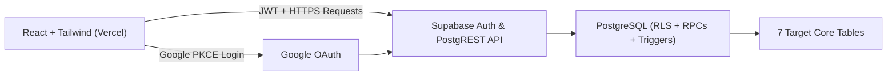

# Ṭullāb al-Bayān — Tech Stack & Backend Architecture

- **Scale:** ~200 students · Single institute (`Asia/Dhaka`, `BDT`)
- **Architecture:** Static SPA Frontend (Vercel) + Serverless Backend-as-a-Service (Supabase)

---

## 1. Approved Tech Stack

| Layer | Technology | Role in This Project |
|---|---|---|
| **Frontend UI** | **React 19 + Vite 7 + Tailwind CSS v4** | Already built in `frontend/`. Fast SPA build and mobile-responsive UI. |
| **Routing & Icons** | **React Router v7 + Lucide React** | Role-protected routes (`/admin`, `/teacher`, `/student`, `/sign-in`) and icons. |
| **Frontend Client SDK** | **`@supabase/supabase-js` (`^2.119.2`)** | Communicates directly with Supabase Auth, PostgREST tables, and PostgreSQL RPCs. |
| **Client ZIP Export** | **`fflate`** *(~8 KB, added in Admin Export)* | Bundles the 6 CSV files + `manifest.json` inside the browser without a backend server. |
| **Client PDF Report** | **`jspdf` + `jspdf-autotable`** *(lazy-loaded on download)* | Renders the Admin tuition fee PDF by billing period and batch entirely in the browser. |
| **Backend & Database** | **Supabase (PostgreSQL + GoTrue Auth + PostgREST)** | Replaces a custom Node/Express/Django server. Hosts auth, API, business rules, and 7 target tables (4 shipped in Day 1; 3 planned in Days 2–4). |
| **DB Versioning & CLI** | **Supabase CLI (`npx --yes supabase@3.2.0`) + Docker Desktop & WSL2** | Local development (`start`, `db reset`), type generation, and forward migrations (`db push`). |
| **Frontend Hosting** | **Vercel (HTTPS)** | Hosts the React app with automatic Preview (Staging) and Production (Live) deployments. |

---

## 2. How the Backend Works (No Separate Server Needed)

Supabase acts as the entire backend. The React app talks directly to Supabase using the signed-in user's JWT, and PostgreSQL enforces every permission and business rule server-side:

### The 4 Backend Pieces Inside Supabase
1. **Authentication (`Supabase Auth` + Google OAuth PKCE):**
   - Admins, Teachers, and Students sign in with Google (no passwords stored in our database).
   - Every browser request carries a signed Supabase JWT identifying `auth.uid()`.
   - Unlisted Google accounts get no role row in `user_roles` and see only the **"Awaiting institute access"** screen until an Admin links them.
2. **Auto-Generated CRUD API (`PostgREST`):**
   - `supabase.from('homework_assignments')`, `supabase.from('monthly_tuition')`, etc. expose REST endpoints automatically—no Express routes or controllers to write or maintain.
3. **Authorization Middleware (`Row Level Security — RLS`):**
   - Every query checks PostgreSQL RLS policies via `auth.uid()` and `user_roles`:
     - **Admin:** Full operational access (except direct `auth.users`, accessed safely via RPC).
     - **Teacher:** Attendance & Homework across all 7 batches; blocked from `monthly_tuition` and direct `students` emails.
     - **Active Student:** Own attendance, own tuition, and current batch homework.
     - **Former Student (`is_active = false`):** Read-only own historical attendance (marked rows) & tuition; `0` homework rows.
4. **Server-Side Business Logic (`PostgreSQL RPCs & Triggers`):**
   - Complex or multi-step operations run atomically inside PostgreSQL via `supabase.rpc(...)` and table triggers:
     - **Day 1 Shipped RPCs (`202611230001`):** `get_teacher_roster()`, `list_pending_auth_users()`, `link_student_account()`, `unlink_student_account()`.
     - **Days 2–4 Planned RPCs (`202611230003`–`0005`):** `import_students_csv()`, `create_attendance_session()`, `delete_empty_attendance_session()`, `generate_monthly_tuition()`.
     - **Triggers:** `normalize_student_fields()` (updates `batch_assigned_at` on transfer and Option A reactivation), `protect_homework_publish_metadata()` (preserves `published_at`/`published_by` on edit), and planned `validate_monthly_tuition_write()` (blocks invalid `Paid` marks and tracks `paid_at`).

> **Future Extension:** If Al Bayan later adds **online payment gateways** (bKash/SSLCommerz/Stripe) or **automated SMS/email notifications**, add **Supabase Edge Functions** (TypeScript/Deno) for private webhook secrets—still no full backend server needed.

---

## 3. Environments & Security Rules

| Environment | Frontend Host | Supabase Target | Migration / Env Rules |
|---|---|---|---|
| **Local** | Vite (`localhost:5173`) | Local Docker (`supabase start`) | Uses `frontend/.env.local` (gitignored); `supabase db reset` applies migrations + dev `seed.sql`. |
| **Staging** | Vercel Preview | Staging Supabase project | Test Phase 1 → Phase 2 upgrade (`supabase db push`) safely before Live. |
| **Live** | Vercel Production (`main`) | Live Supabase project | **Never** run `db reset` or demo `seed.sql`. Register Phase 1 first (`migration repair`), then `supabase db push`. |

- **Secret Safety:** Only `VITE_SUPABASE_URL` and `VITE_SUPABASE_PUBLISHABLE_KEY` go into Vercel/browser env vars. Keep Google OAuth Client Secret and Supabase `service_role` keys strictly out of `frontend/`.

---

## 4. Related Docs
- [DATABASE_DESIGN.md](./DATABASE_DESIGN.md) — Locked 7-table schema, RLS matrix, forward migrations, and developer tasks.
- [DAY1_FOUNDATION_HANDOFF.md](./DAY1_FOUNDATION_HANDOFF.md) — Current Day 1 verification status, exact shared contracts, and developer onboarding guide.
- [AUTH_SETUP.md](../frontend/AUTH_SETUP.md) — Local Supabase startup and Google OAuth PKCE environment setup.
